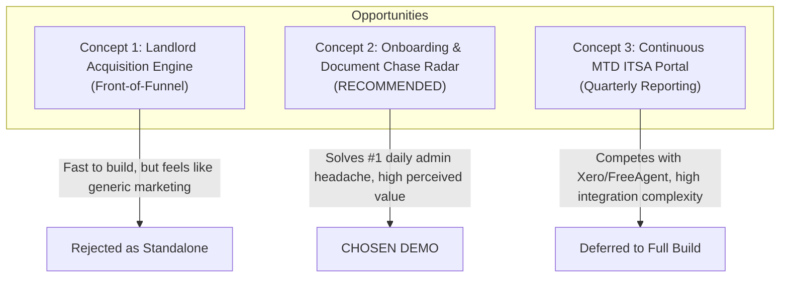
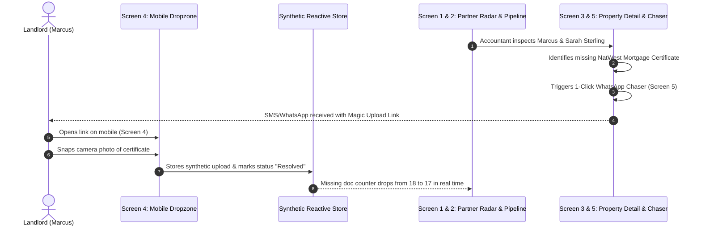
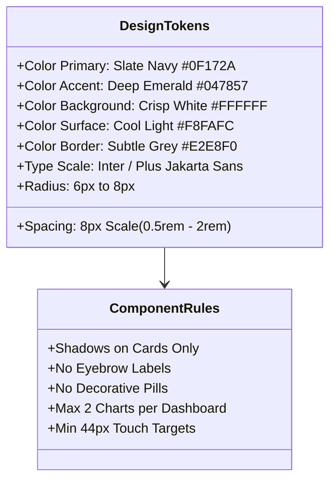
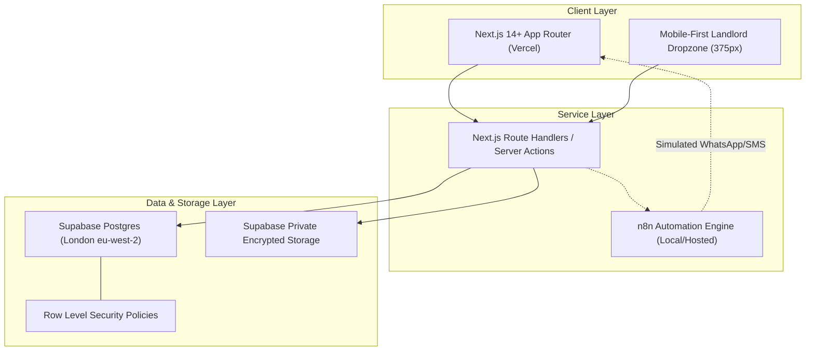
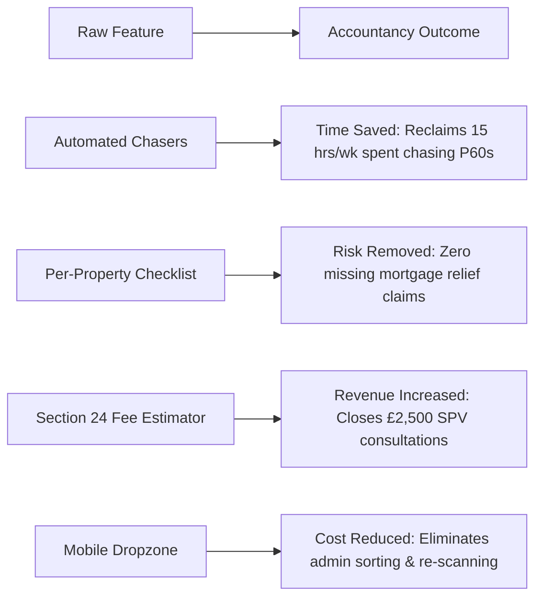
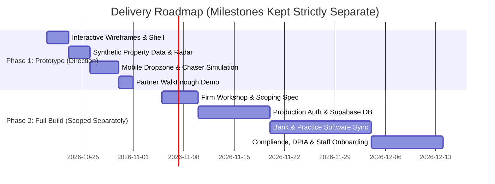

# Strategic Implementation Plan & Architecture: "Kickstart"
**Target Client:** KP Accountants / KP Tax Consultants ([kptc.co.uk](https://www.kptc.co.uk/))  
**Specialism:** UK Property Tax, Landlords, SPVs, Rental Income, Self Assessment, Corporation Tax  
**Author:** Mercian Wealth Automation ("Systems for Accountants")  
**Status:** Brainstorming & Planning Only — Awaiting Client & Partner Approval  
**Date:** October 2026  

---

## 1. Summary & Chosen Concept

### Executive Summary
KP Accountants (operating online as KP Tax Consultants at `kptc.co.uk`) is led by qualified chartered professionals (ATT, CTA, FCA) with technical capability in complex tax advisory. However, their digital footprint under-represents their strengths:
- Their property specialism is buried as one generic bullet point among six unrelated sectors.
- Prospect enquiry is constrained to an unguided 5-field form with zero response commitments.
- Post-enquiry operations rely on manual chasing of disjointed documents (mortgage statements, P60s, title deeds, tenancy agreements) across multiple property owners and SPVs.

We do not propose selling an abstract "AI overhaul" or a generic marketing redesign. We propose building a high-impact, demonstration prototype focused on the single most painful operational bottleneck in property tax accounting: **Landlord Onboarding & Document Chase Management**.

### Chosen Direction: Complete 3-Tier Demonstration Architecture
To ensure the prototype proves competence both to external prospects and internal practice staff, the system implements three tightly integrated tiers:
1. **Tier 1: Public Acquisition Landing Page (`kptc.co.uk` Redirection):**
   - High-conviction proposition for UK landlords and property investors.
   - Fixes the buried property specialism with dedicated pillars (Section 24, SPVs, MTD, 60-day CGT).
   - Replaces the 5-field static form with an **Interactive Section 24 & SPV Property Tax Calculator**.
   - Solves the single-line MTD text with a comprehensive **Making Tax Digital 2026/2027 Mandate Guide**.
   - Includes senior leadership credentials for Pritpal Chaggar (CTA) and Kalpesh Patel (FCA).
   - Features a **Dual Portal Login Modal** giving instant access to either the Accountant or Client portal.
2. **Tier 2: Accountant Practice OS (Partner Command Hub):**
   - Partner Command Radar tracking active portfolios, missing compliance items, and WIP.
   - Landlord Pipeline Kanban/List with automated document checklist progression.
   - Per-Property Asset & Per-Person AML Document Workspace.
   - Multi-Channel Chaser (WhatsApp/SMS/Email) with audit trail.
   - Instant 1-click switcher to test the Client Portal or return to the Public Website.
3. **Tier 3: Dedicated Client Portal ("Landlord Dropzone & Vault"):**
   - 375px mobile camera upload dropzone with zero passwords required.
   - Live reactive synchronization back to the Partner Radar upon document upload.
   - Encrypted Document Vault for viewing verified title deeds, ASTs, and tax slips.
   - Direct switchers to the Accountant Portal or Public Website.

---

## 2. Site Findings (Evidence Only)

A comprehensive audit of `kptc.co.uk` was performed against desktop and mobile viewports. Only directly verified attributes are recorded below. Unsubstantiated claims have been discarded.

| Audit Area | Verified Finding on `kptc.co.uk` | Impact on Practice Growth & Operations |
| :--- | :--- | :--- |
| **Firm Identity & Leadership** | Run by Pritpal Chaggar (BSc Hons, ATT, CTA - Chartered Tax Advisor) and Kalpesh Patel (BSc Hons, FCA - Fellow Chartered Accountant). Domain branded as "KP TAX Consultants". | Strong credentials exist, but CTA/FCA regulatory credentials and badges are plain text rather than verified accreditation crests. |
| **Property Specialism** | **Buried.** "Property investors and developers" appears only as 1 of 6 generic bullet points under "FOCUS SECTORS" (alongside Contractors, Construction, Dentists, Retail, E-commerce). | Landlords visiting the site cannot determine whether the firm handles Section 24 mortgage relief, SPV incorporations, SDLT planning, or furnishing allowances. |
| **Contact Mechanism** | **Form-only.** Requires 5 mandatory fields (`First Name *`, `Last Name *`, `Email *`, `Subject *`, `Message *`). | High friction for mobile visitors. No direct telephone number on homepage, no partner email, no physical office address, no online booking link (Calendly), and **zero response time promise**. |
| **Trust Signals** | **Thin.** No client testimonials, no case studies, no Trustpilot/Google Reviews widget, no Companies House registration number, and no VAT number visible on homepage. | Visitors have no external social proof or client proof blocks to validate past delivery before submitting sensitive financial data. |
| **Making Tax Digital (MTD)** | **Single generic line.** Under "DIGITAL COMPLIANCE": *"Assessing MTD compliance and providing solutions to meet requirements."* | No guidance regarding MTD for ITSA (April 2026 threshold for landlords with gross income > £50k; April 2027 > £30k). Missing an urgent commercial advisory hook. |
| **Spelling & Copy Errors** | **Confirmed Typo.** Heading reads **`ACCOUNTACY`** (missing the letter 'N'). In addition, "EIS & EIS tax planning" repeats EIS instead of SEIS. Trailing bullet punctuation is inconsistent. | Typos on a tax advisory website damage the perception of rigorous attention to detail needed for statutory accounts and tax investigations. |
| **Technical Stack & Speed** | Built on Wix (`thunderbolt-renderer`, revision 45). Heavy legacy bundle overhead with client-side hydration delays. | Slower First Contentful Paint (FCP) and Time to Interactive (TTI) on mobile 4G networks compared to modern lightweight static/server architectures. |
| **Mobile Layout & Ergonomics** | Rigid mesh layout (`#SITE_CONTAINER` fixed at 320px base). Navigation collapses into an overflow "More" drawer. Form fields lack mobile-native autocomplete tags. | Pinched reading experience on 390px/414px mobile screens. Tap targets on certain sub-links are under 44px. |
| **Search & AEO Findability** | Missing structured Schema.org markup (`AccountingService`, `LocalBusiness`, `FAQPage`). Zero landlord-specific keywords (0 mentions of landlord, rental income, Section 24, mortgage interest, SPV). | Modern AI search engines (Perplexity, ChatGPT Search, Google AI Overviews) cannot parse the site as a specialized property tax firm. |

---

## 3. Three Concepts Compared

We evaluated three potential prototype concepts using the framework: **Biggest Prize, Fastest Payoff, Least Work**.



### Concept 1: Public Landlord Acquisition & Section 24 Fee Estimator
- **Single Bottleneck Removed:** Unqualified enquiries and high drop-off from landlords who do not know their compliance costs or potential tax savings.
- **Primary Users:** Prospective landlords, property investors, practice business development.
- **Outcome Delivered:** **Revenue Increased.** Captures high-intent property leads through an interactive calculator (Turnover, Number of Properties, Personal vs SPV ownership) and outputs an estimated tax relief profile and upfront fixed-fee quote.
- **Why Rejected as the Primary Prototype:** While valuable, presenting *only* a front-end lead calculator risks looking like a standard digital marketing agency pitch. Accountants are naturally skeptical of "more leads" if their current practice is already overwhelmed with unbilled administrative chasing.

### Concept 2: Landlord Onboarding & Per-Property Document Chase Radar (RECOMMENDED)
- **Single Bottleneck Removed:** Administrative delays, unbilled hours, and compliance risk during client onboarding and year-end document gathering.
- **Primary Users:** Both the accountant (Partner / Practice Manager) and the client (Landlord / Property Owner).
- **Outcome Delivered:** **Time Saved & Risk Removed.** 
  - Cuts onboarding turnaround from 4 weeks to 48 hours.
  - Replaces manual email/WhatsApp back-and-forth with automated, structured checklists tailored per property and per owner.
  - Provides a single partner view of all missing documents across the practice.
- **Why Chosen:** It offers the **biggest prize and fastest payoff with realistic scope**. It immediately proves to KP Accountants that we understand their day-to-day operational frustration. Seeing a real-time radar with 1-click WhatsApp chasers connected to a mobile photo uploader makes the future feel immediately tangible.

### Concept 3: Year-Round MTD ITSA Quarterly Compliance Hub
- **Single Bottleneck Removed:** The panic of January tax season by enforcing continuous quarterly digital record submissions for property income.
- **Primary Users:** Both the accountant and the landlord.
- **Outcome Delivered:** **Cost Reduced & Risk Removed.** Smooths the practice workload across 4 quarters and eliminates HMRC late-filing penalty risk for landlords.
- **Why Rejected as the Primary Prototype:** Overly ambitious for an initial demonstration. A full MTD compliance platform requires live open-banking integrations, HMRC MTD API bridging, and categorization engines that duplicate commercial tools like Xero, Hammock, or Dext. Building a prototype of this risks creating uncertainty around viability.

---

## 4. Prototype Scope (Maximum 5 Screens)

The prototype will be built with 5 tightly integrated, interactive screens using realistic synthetic UK property tax data.



### Screen 1: Partner Command Dashboard ("Practice Radar")
- **Purpose:** Executive overview for the practice partner (Kalpesh / Pritpal) showing operational health across the property portfolio.
- **Key Metrics (Cards with Lucide Icons):**
  1. *Active Landlord Portfolios:* 42 (covering 118 property units).
  2. *Missing Documents Pending:* 18 items across 9 clients.
  3. *Upcoming MTD/ITSA Deadlines:* 6 submissions due within 30 days.
  4. *Unbilled WIP Value:* £12,450 tied up in delayed onboarding.
- **Visuals:** 
  - Clean mini-chart (bklit/Recharts style): Monthly Onboarding Cycle Time (days to completion: reduced from 26 days to 4 days).
  - Urgent Action Table: Top 5 clients with overdue documents, showing days outstanding, assigned manager, and quick-action trigger.
- **Mobile Viewport (375px):** Stacked cards with large touch targets, sticky filter bar at top, horizontal scroll eliminated.

### Screen 2: Client Pipeline & Onboarding Status List
- **Purpose:** Central list of all landlord accounts with real-time status tracking.
- **Structure:**
  - Search bar + quick filters: *All Entities*, *SPV Limited Companies*, *Individual Landlords*, *Joint Owners*.
  - Tabular list showing:
    - Client / Entity Name (e.g. "Sterling Property Holdings Ltd", "Marcus & Sarah Sterling", "Kensington BTL Portfolio").
    - Structure: *Individual (BTL)* vs *SPV Ltd Co*.
    - Status Badge: `Intake Submitted`, `KYC/AML In Review`, `Chasing Docs (4 Missing)`, `Computation Ready`.
    - Progress Bar: e.g. 75% complete (6/8 documents verified).
    - Last Contacted: e.g. "Chased yesterday via WhatsApp".
- **Mobile Viewport (375px):** Card-based list view where each card shows entity name, status pill, progress bar, and a prominent "View Checklist" tap target.

### Screen 3: Property & Owner Document Workspace (Accountant Detail View)
- **Purpose:** Granular inspection screen for a single client account.
- **Synthetic Entity Example:** *"Marcus & Sarah Sterling (4 Buy-to-Let Properties + 1 Commercial Unit)"*.
- **Workspace Layout:**
  - **Party 1 (Marcus):** Passport (Verified), Proof of Address (Verified), UTR (Verified), P60 Employment Income (Verified).
  - **Party 2 (Sarah):** Passport (Verified), Proof of Address (**Missing - Overdue 6 days**), UTR (Verified).
  - **Property Breakdown:**
    - *14 High Street, Cheltenham (Joint Residential BTL):* NatWest Mortgage Interest Cert (**Missing**), AST Tenancy Agreement (Verified), Letting Agent Annual Summary (Verified).
    - *22 Park Road, Gloucester (SPV Ltd Co):* Barclays Commercial Loan Statement (Verified), Insurance Schedule (Verified).
  - **Action Header:** Prominent "Send Multi-Channel Chaser" button.

### Screen 4: Mobile Landlord Dropzone (Client Mobile View — 375px First)
- **Purpose:** The exact screen the client sees when opening a chase notification on their phone.
- **Ergonomics:**
  - Passwordless entry via simulated secure token (no registration wall).
  - Personalized greeting: *"Hello Marcus, please provide the 2 outstanding documents for your 2024/25 Property Tax Return"*.
  - Item 1: *NatWest Mortgage Interest Certificate (14 High Street)* — Tap to choose file or activate mobile camera.
  - Item 2: *Sarah's Proof of Address (Council Tax or Bank Statement)* — Tap to upload.
  - Clear guidance: "Clear photo or PDF accepted. Max 10MB."
  - Upload Confirmation: Immediate green checkmark with timestamp: "Received. Kalpesh will review this within 1 working day."
  - Minimum touch target: 48px height on all buttons.

### Screen 5: Multi-Channel Chaser Modal & Activity Log
- **Purpose:** Enables the practice manager to trigger polite, personalized reminders without drafting messages manually.
- **Features:**
  - Channel selector: *WhatsApp Business*, *SMS*, *Email*.
  - Auto-generated template:
    > *"Hi Marcus, Kalpesh here from KP Accountants. We are finalizing your 2024/25 property tax return to ensure your mortgage interest deductions are applied. We just need your NatWest certificate for 14 High Street. You can snap a photo directly here: [secure link]. Thank you!"*
  - Simulated "Send Now" button which triggers a success toast and updates the activity log timestamp in real time.

---

## 5. Design System & Frontend Specifications

To guarantee the prototype looks like an enterprise UK financial product and avoids generic AI aesthetics, strict design constraints are established:



### Component Library
- **Selected Library:** **shadcn/ui** (built on **Radix UI** primitives and **Tailwind CSS**).
- **Justification:** 
  1. Accessible by default (WCAG 2.1 AA compliant keyboard navigation and screen readers).
  2. Complete code ownership (components live directly in the project codebase, preventing third-party theme collisions).
  3. Standardized tokens for modals, drawers, tables, popovers, and tabs.
  4. Industry standard for high-end SaaS applications in professional services.

### Palette & Design Tokens
Random hexadecimal values are strictly forbidden. The palette uses an authoritative British corporate accounting theme (Deep Slate & British Racing Green/Emerald accents):

| Token Name | CSS Variable | Hex Value | Intended Usage |
| :--- | :--- | :--- | :--- |
| `primary` | `--primary` | `#0F172A` (Slate 900) | Primary headers, primary action buttons, active navigation states |
| `primary-foreground` | `--primary-foreground` | `#FFFFFF` | Text on dark buttons and headers |
| `secondary` | `--secondary` | `#F1F5F9` (Slate 100) | Secondary action buttons, badge backgrounds, table headers |
| `accent` | `--accent` | `#047857` (Emerald 700) | Highlighting tax savings, verified documents, positive status |
| `accent-light` | `--accent-light` | `#ECFDF5` (Emerald 50) | Success badge backgrounds, completed checklist rows |
| `neutral-bg` | `--background` | `#FFFFFF` | Main canvas background |
| `neutral-surface` | `--surface` | `#F8FAFC` (Slate 50) | Sidebar, card backgrounds, modal wrappers |
| `neutral-border` | `--border` | `#E2E8F0` (Slate 200) | Dividers, card borders, table row borders |
| `neutral-text` | `--text-main` | `#1E293B` (Slate 800) | Primary body copy and table text |
| `neutral-muted` | `--text-muted` | `#64748B` (Slate 500) | Secondary metadata, dates, explanatory captions |
| `warning` | `--warning` | `#B45309` (Amber 700) | Approaching deadlines, missing documents pending |
| `warning-bg` | `--warning-bg` | `#FFFBEB` (Amber 50) | Warning badges and attention callouts |
| `error` | `--error` | `#B91C1C` (Red 700) | Overdue compliance items, rejected document uploads |
| `error-bg` | `--error-bg` | `#FEF2F2` (Red 50) | Error alert banners and rejected document badges |

### Spacing & Grid System
- Built strictly on an **8px grid scale**, defined in `rem` units (assuming `1rem = 16px`):
  - `space-1` = `0.25rem` (4px) — micro-spacing inside badges
  - `space-2` = `0.5rem` (8px) — spacing between icons and text
  - `space-3` = `0.75rem` (12px) — compact form padding
  - `space-4` = `1.0rem` (16px) — standard card padding on mobile
  - `space-6` = `1.5rem` (24px) — desktop card padding and section margins
  - `space-8` = `2.0rem` (32px) — grid gutters and container padding
  - `space-12` = `3.0rem` (48px) — major layout section vertical rhythm

### Typography
- **Primary Font:** `Inter` or `Plus Jakarta Sans` via Next.js `next/font/google`.
- **Numerical Figures:** `tabular-nums font-mono` for all currency amounts, UTR numbers, and dates to ensure visual alignment in tables and cards.
- **Scale:**
  - Page Title: `text-2xl font-bold tracking-tight text-slate-900` (24px)
  - Section Heading: `text-lg font-semibold text-slate-900` (18px)
  - Body Text: `text-sm font-normal text-slate-700 leading-relaxed` (14px)
  - Metadata / Captions: `text-xs font-medium text-slate-500` (12px)

### UI Rules
- **Shadows:** Standard `shadow-sm` allowed on cards and modals only. No drop-shadows on buttons, text, or table rows.
- **No Vibe-Coded Fluff:** Zero floating decorative gradients, no pulsing neon orbs, no meaningless labels (e.g. "AI Cockpit", "Neural Feed").
- **No Eyebrow Labels:** Do not place uppercase micro-text above headings (e.g. no "THE FUTURE OF ACCOUNTING"). Headings must speak directly.
- **Charts:** Maximum 2 charts on the dashboard. Used strictly to display operational turnaround time and checklist completion rates.
- **Icons:** Standardized Lucide icons for all metric cards and document types (e.g. `FileText`, `AlertCircle`, `CheckCircle2`, `Clock`, `Smartphone`, `Building2`).
- **Footer:** Must contain realistic British corporate placeholders:
  > *"KP Accountants / KP Tax Consultants is the trading name of KP Tax Consultants Ltd. Registered in England & Wales (Company No. [Placeholder: 12345678]). Registered Office: [Placeholder: Suite 4, High Street, London]. Regulated for a range of investment business activities by the Institute of Chartered Accountants in England and Wales."*

---

## 6. Technical Architecture (Stack & Data Model)

The prototype architecture will use modern, serverless cloud tooling designed for rapid iteration and rock-solid reliability:



### Stack Components
1. **Frontend / Application Framework:** Next.js (App Router, TypeScript, React Server Components).
2. **Hosting & Edge Delivery:** Vercel (Edge Network, UK/London region deployment).
3. **Database & Storage:** Supabase (PostgreSQL with Row Level Security, private object storage buckets).
4. **Workflow & Notification Automation:** n8n (for chaining document chase triggers, webhook listeners, and multi-channel message dispatch).
5. **Code Management:** GitHub repository with branch protection and strict linting.

### Target Project Folder Structure
```text
uk-accountancy-os-prototype/
├── app/
│   ├── (admin)/
│   │   ├── dashboard/             # Screen 1: Partner Command Radar
│   │   ├── clients/               # Screen 2: Client Pipeline List
│   │   │   └── [id]/              # Screen 3: Property & Owner Workspace
│   │   └── layout.tsx             # Admin sidebar and partner navigation
│   ├── (client)/
│   │   └── portal/
│   │       └── [token]/           # Screen 4: Mobile Landlord Dropzone
│   ├── api/
│   │   ├── chaser/                # Screen 5: Multi-channel nudge trigger
│   │   └── upload/                # Secure signed URL upload handler
│   ├── layout.tsx                 # Root layout with fonts & theme tokens
│   └── page.tsx                   # Practice front door & lead intake
├── components/
│   ├── ui/                        # Isolated shadcn/ui components
│   ├── dashboard/                 # Radar charts, metric cards, overdue table
│   ├── clients/                   # Property checklists, owner tabs
│   ├── dropzone/                  # Mobile camera capture & upload card
│   └── shared/                    # Header, footer, regulatory badges
├── lib/
│   ├── data/                      # Synthetic UK landlord data store
│   ├── types/                     # TypeScript interfaces (Entities, Docs, Chasers)
│   └── utils.ts                   # Tailwind merge and formatting helpers
├── public/                        # Static assets, SVG icons, dummy documents
└── KICKSTART.md                   # This implementation roadmap
```

### Relational Data Model (PostgreSQL / Supabase)
```sql
-- Core Client Entities (Individual Landlords, Partnerships, SPVs)
CREATE TABLE clients (
    id UUID PRIMARY KEY DEFAULT gen_random_uuid(),
    entity_name TEXT NOT NULL,                -- e.g. 'Marcus & Sarah Sterling'
    entity_type TEXT NOT NULL,                -- 'individual', 'joint', 'spv_ltd'
    company_number TEXT,                      -- e.g. '14285721' (if SPV)
    primary_email TEXT NOT NULL,
    primary_phone TEXT NOT NULL,
    status TEXT NOT NULL DEFAULT 'intake',    -- 'intake', 'kyc_pending', 'chasing_docs', 'review_ready'
    assigned_accountant TEXT NOT NULL,        -- 'Kalpesh Patel', 'Pritpal Chaggar'
    created_at TIMESTAMPTZ DEFAULT NOW()
);

-- Individual Associated Parties (for Joint ownership or Directors)
CREATE TABLE client_parties (
    id UUID PRIMARY KEY DEFAULT gen_random_uuid(),
    client_id UUID REFERENCES clients(id) ON DELETE CASCADE,
    full_name TEXT NOT NULL,                  -- 'Marcus Sterling'
    relationship TEXT NOT NULL,               -- 'primary_owner', 'joint_spouse', 'director'
    utr_number TEXT,                          -- 10-digit synthetic UTR
    national_insurance_number TEXT            -- Synthetic NI
);

-- Properties Owned
CREATE TABLE properties (
    id UUID PRIMARY KEY DEFAULT gen_random_uuid(),
    client_id UUID REFERENCES clients(id) ON DELETE CASCADE,
    address_line TEXT NOT NULL,               -- '14 High Street, Cheltenham'
    postcode TEXT NOT NULL,
    property_type TEXT NOT NULL,              -- 'residential_btl', 'hmo', 'commercial'
    ownership_split TEXT NOT NULL             -- '50/50 Joint', '100% SPV'
);

-- Checklist Requirements per Person & Property
CREATE TABLE document_requests (
    id UUID PRIMARY KEY DEFAULT gen_random_uuid(),
    client_id UUID REFERENCES clients(id) ON DELETE CASCADE,
    party_id UUID REFERENCES client_parties(id),
    property_id UUID REFERENCES properties(id),
    category TEXT NOT NULL,                   -- 'id_aml', 'tax_record', 'mortgage', 'tenancy'
    document_title TEXT NOT NULL,             -- 'NatWest Mortgage Interest Certificate'
    status TEXT NOT NULL DEFAULT 'pending',   -- 'pending', 'uploaded', 'verified', 'rejected'
    is_overdue BOOLEAN DEFAULT FALSE,
    due_date DATE NOT NULL,
    file_storage_path TEXT,                   -- Path in private encrypted bucket
    uploaded_at TIMESTAMPTZ
);

-- Multi-Channel Communication Audit Log
CREATE TABLE communication_logs (
    id UUID PRIMARY KEY DEFAULT gen_random_uuid(),
    client_id UUID REFERENCES clients(id) ON DELETE CASCADE,
    channel TEXT NOT NULL,                    -- 'whatsapp', 'sms', 'email'
    recipient TEXT NOT NULL,
    message_body TEXT NOT NULL,
    triggered_by TEXT NOT NULL,               -- 'manual_partner', 'automated_schedule'
    sent_at TIMESTAMPTZ DEFAULT NOW()
);
```

### Access Control & User Roles
1. **Practice Partner / Admin:** Full visibility across all clients, billing figures, unbilled WIP, audit logs, and communication templates.
2. **Accountant / Practice Manager:** Ability to review uploaded documents, approve/reject files, trigger chaser messages, and update property schedules.
3. **Client / Landlord:** Scoped passwordless access via secure HMAC magic token URL (`/portal/[token]`). Can **only** see their own pending document checklist and upload files. Zero access to internal notes or practice metrics.

---

## 7. Security, Data Protection & Legal Delivery Risks

Handling UK financial documentation (passports, driving licences, utility bills, UTR numbers, P60s, bank statements) introduces significant legal and regulatory responsibilities.

```mermaid
flowchart LR
    subgraph Upload Flow
        Phone["Landlord Smartphone"] -->|TLS 1.3 Transport| API["Upload Handler"]
        API -->|Generate Pre-Signed PUT URL| Bucket["Private Storage Bucket (AES-256)"]
        Bucket -->|File Stored with Random UUID| Storage["Supabase Storage (London)"]
    end
    
    subgraph Access Flow
        Partner["Accountant Browser"] -->|Authenticated Session + RLS| Viewer["Document Previewer"]
        Viewer -->|Pre-Signed Read URL (Expires in 60s)| Storage
    end
```

### Strict Security Implementation Rules
1. **Private Storage Buckets & Pre-Signed URLs:**
   - Under no circumstances will documents be stored in public-accessible URLs.
   - Uploads will use short-lived, pre-signed upload URLs generated server-side.
   - Document viewing will occur through timed signed URLs with an expiration lifetime of 60 seconds.
2. **Row Level Security (RLS):**
   - Every Supabase table will enforce PostgreSQL RLS policies ensuring client magic tokens can only read/write records tied directly to their `client_id`.
3. **UK/EU Data Residency:**
   - All serverless database instances, storage buckets, and server runtime regions must be provisioned in the **UK (London, `eu-west-2`)** or EU (Ireland, `eu-west-1`).
4. **Data Retention & Disposal Schedules:**
   - Tax compliance documents must be retained for 6 years following the statutory filing deadline (in accordance with HMRC compliance guidelines for companies and self-employed individuals).
   - AML identity verification files (passports, proof of address) must be segregated and subjected to automated review after client disengagement.
5. **Data Protection Impact Assessment (DPIA) Requirement:**
   - Before taking any prototype into production handling live client data, a formal DPIA must be conducted with the firm's nominated Data Protection Officer (DPO), given the processing of government-issued identification and personal tax identifiers.

### Honest Legal & Compliance Disclaimer
> [!WARNING]
> **Prototype Data Boundary:** The prototype will operate using **100% synthetic, fictional data**. No real client names, passports, UTRs, or bank records will be entered, uploaded, or processed during demonstration.  
> **No Premature Regulatory Claims:** We do not claim that this prototype is "GDPR compliant" or "certified with UK GDPR". Regulatory compliance is an operational and organizational state involving verified contracts, sub-processor agreements, ICO registrations, and staff training — not a feature of software code.

---

## 8. Mobile Acceptance Criteria & Viewport Standards

Because over 60% of landlord communication occurs while clients are on the go, the client upload journey must be flawless on mobile screens:

### Mobile Viewport Benchmarks
- **Primary Design Canvas:** **375px** width (iPhone SE / standard iOS baseline).
- **Mandatory Test Widths:** `360px` (standard Android), `390px` (iPhone 14/15/16), `768px` (iPad portrait), and `1280px` (Desktop).
- **Horizontal Scroll Policy:** **Zero tolerance for horizontal overflow (`overflow-x: hidden` / clipping).** Any view producing side-scrolling at 360px is considered defective.

### Ergonomics & Touch Targets
- **Minimum Interactive Target Size:** `44px x 44px` on all buttons, links, inputs, and upload targets (conforming to WCAG 2.5.5).
- **Thumb Zone Design:** All primary actions on the mobile dropzone (camera capture button, upload submit, confirmation) must be placed in the lower half of the screen.
- **Native Input Modes:**
  - Phone input fields must use `type="tel"` and `autoComplete="tel"`.
  - Email fields must use `type="email"` and `autoComplete="email"`.
  - UTR fields must use `inputMode="numeric"` to trigger the numerical keypad.
- **Camera & Photo Integration:** The upload interface must leverage HTML5 file capture `<input type="file" accept="image/*,application/pdf" capture="environment" />` to allow immediate snapping of paper certificates.

### Performance Acceptance Criteria
- **Lighthouse Mobile Score Target:** **>= 90** across Performance, Accessibility, Best Practices, and SEO.
- **Maximum Initial JS Bundle:** `< 120 KB` gzip on initial page load.
- **Time to Interactive (TTI) on 4G Fast Connection:** `< 2.2 seconds`.

---

## 9. Messaging, Positioning & AEO Strategy

### Moving from Technical Features to Client Outcomes
Accountants do not buy "automation", "AI algorithms", or "databases". They invest in systems that either save their time, reduce operational cost, increase advisory fees, or eliminate compliance risk.



| Avoid (Feature / Buzzword Copy) | Use (Commercial Outcome Copy) |
| :--- | :--- |
| "Our AI automatically parses client tax slips." | *"We eliminate manual data entry so your senior team spends their billable hours on tax advisory rather than paper sorting."* |
| "A centralized workflow automation engine." | *"We cut onboarding turnaround from four weeks to 48 hours, keeping your cash flow moving."* |
| "Send automated SMS and WhatsApp bots." | *"We gently remind joint landlords about missing mortgage certificates so you never miss a filing deadline."* |
| "Cutting-edge Making Tax Digital tech." | *"We prepare your landlord clients for quarterly digital reporting without increasing practice overhead."* |

### Voice & Perspective
All practice copy must use **"we"** (collective practice voice), projecting institutional stability and team support, rather than "I".

### Answer Engine Optimization (AEO) Blueprint for kptc.co.uk
Modern property investors do not browse ten pages of a directory; they query AI search engines (Perplexity, ChatGPT, Claude) with specific prompts: *"Best accountant in the UK for moving 4 buy-to-lets into an SPV"* or *"How does Section 24 affect higher rate landlords in 2026?"*

To ensure KP Accountants is surfaced as the authoritative answer:
1. **Structured FAQ Schema:** Implement Schema.org `FAQPage` addressing high-intent queries:
   - *Should I buy investment property in my own name or through an SPV Limited Company?*
   - *How do I calculate mortgage interest tax credit under Section 24?*
   - *What records do landlords need to maintain for MTD for ITSA starting April 2026?*
2. **Dedicated Property Sub-Hub:** Create a focused, high-authority `/property-tax` destination with clear service blocks (Portfolio Restructuring, SDLT Relief, Annual Landlord Self Assessment, Capital Allowances for Furnished Holiday Lets).
3. **Verified Proof Blocks:** Prominently embed CTA and FCA professional badges alongside anonymized portfolio results (e.g. *"Assisted a portfolio landlord in restructuring 8 residential units into a family investment company, reducing effective tax rate by 18%"*).

---

## 10. Milestones: Prototype vs. Full Build

To maintain complete clarity of scope, the demonstration prototype is kept strictly separate from the subsequent production build.



### Phase 1: The Prototype (Demonstrating Direction & Gaining Buy-In)
- **Goal:** Prove competence, remove technical uncertainty, and show KP Accountants exactly how their onboarding operations will look and feel.
- **Scope Limits:** 5 interactive screens, synthetic mock database, simulated WhatsApp/email triggers, zero live client data, zero production bank connections.
- **Milestone P1:** Interactive Next.js design system with shadcn/ui components and tailored property styling.
- **Milestone P2:** Partner Command Dashboard and Landlord Pipeline populated with realistic synthetic landlord cases.
- **Milestone P3:** Mobile Dropzone (375px) with functional file upload simulation and live reactive state sync back to the Partner Radar.
- **Milestone P4:** Partner Demo Walkthrough session demonstrating the end-to-end flow.

### Phase 2: The Full Build (Subject to Separate Commercial Scoping)
*Note: The items below represent production engineering requirements. No features, delivery dates, or prices are committed at this stage.*
- Dedicated scoping workshop to map out the firm's existing software stack (e.g. Xero, Dext, Iris, Karbon, Taxfiler).
- Production Supabase infrastructure setup in UK data center with active automated backups and point-in-time recovery.
- Formal DPIA and Data Processing Addendum (DPA) execution with the firm.
- Integration of live production communications (Twilio for SMS/WhatsApp, Postmark/SendGrid for transactional email).
- Bi-directional sync with practice management software (e.g. Karbon or Xero Practice Manager).
- Staff training sessions and phased rollout to an initial pilot cohort of 10 landlords.

---

## 11. Open Questions for KP Accountants

Before any commercial scope or production build can be defined, the following questions must be answered by the partners:

1. **Current Practice Management Stack:** Which core software does the firm currently use for job management, statutory accounts, and tax filing (e.g., Karbon, Senta, AccountancyManager, Taxfiler, IRIS, or spreadsheets)?
2. **Client Volume & Communication Preferences:** What is the active volume of property clients (individual landlords vs SPV companies), and what percentage of them prefer WhatsApp over email for providing documents?
3. **The Current Onboarding Bottle:** What is the single most common reason a landlord's tax return is delayed in December/January (e.g. missing mortgage statements, missing letting agent statements, or delayed joint-owner information)?
4. **MTD Readiness Strategy:** How is the firm planning to handle clients impacted by MTD for ITSA in April 2026? Will the firm mandate cloud software like Xero/Hammock, or offer a managed quarterly bookkeeping service?
5. **Brand Positioning:** Does the firm intend to formally operate as "KP Accountants" alongside "KP Tax Consultants"?

---

## 12. Strategic Risks & Honest Self-Critique

In proposing this prototype, we have identified key strategic and delivery risks that could invalidate our assumptions:

1. **The "Too Busy to Change" Trap:** Accounting partners in small practices (2–10 staff) are notoriously time-poor. Even when a system will save them 15 hours a week, finding 2 hours to review and adopt a new tool is difficult.  
   *Mitigation:* The prototype must demonstrate that it requires zero data migration to test — an accountant can pilot a single client in under 5 minutes without changing their primary ledger.
2. **Over-Engineering vs. Practice Reality:** Small accounting practices often rely on simple email threads and WhatsApp chats because they are familiar. Introducing an overly complex portal with multiple logins will cause clients to revert to emailing messy photo attachments.  
   *Mitigation:* The Landlord Dropzone must remain **strictly passwordless** via tokenized links. If the client has to remember a password, adoption will collapse.
3. **Regulatory & Anti-Money Laundering (AML) Friction:** If the onboarding flow does not capture certified ID that satisfies ICAEW/ACCA Practice Assurance standards, the firm will still have to run a manual verification process outside the platform.  
   *Mitigation:* Confirm early whether the firm uses an existing verification provider (e.g. SmartSearch, Veriphy, Credas) that can be integrated via webhook in Phase 2.
4. **Commercial Misalignment on Scope:** Pitching a £5,000+ custom software solution to a firm that only budgeted £500 for a website refresh will stall negotiations.  
   *Mitigation:* Anchor the discussion around the commercial cost of unbilled admin hours and the commercial fee opportunity of MTD for ITSA advisory, ensuring the prototype sells a measurable return on investment.

---

*This Kickstart document serves as the strategic blueprint for Mercian Wealth Automation's prototype demonstration for KP Accountants / KP Tax Consultants. Next step: Client review and approval.*
