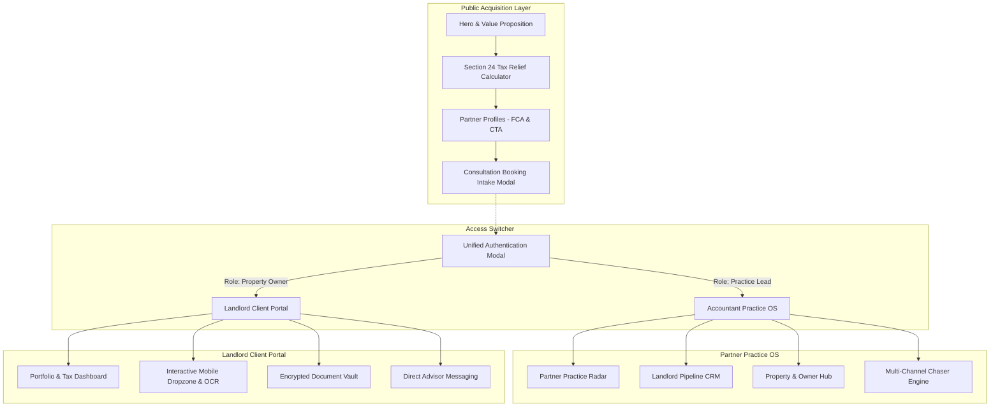

# KP Tax Consultants Ltd — Practice OS & Landlord Client Portal

A commercial demonstration platform and operating system designed for **KP Tax Consultants Ltd** (`https://www.kptc.co.uk/`). Built to replace fragmented email and legacy software workflows with an integrated, luxury client acquisition front-end, high-efficiency partner practice management OS, and an intuitive, mobile-first client document portal.

---

## 🌟 Executive Overview

KP Tax Consultants specialises in UK property tax advisory, Section 24 portfolio restructuring, smart company incorporations, and owner-managed business compliance. 

This platform unifies three core environments:
1. **Public Practice Acquisition Front-End**: High-conversion landing experience featuring an interactive Section 24 Landlord Tax Relief Calculator, verified case studies, partner credentials (Kalpesh Patel FCA & Pritpal Chaggar CTA), and instant consultation booking.
2. **Accountant Practice OS**: Partner dashboard equipped with the Partner Practice Radar, Landlord Pipeline CRM, Property & Owner Hub, and automated Multi-Channel Chasers (WhatsApp/SMS/Email).
3. **Dedicated Landlord Client Portal**: Frictionless client portal with real-time tax liability tracking, encrypted document vault, direct advisor messaging thread, and an OCR Mobile Dropzone with live 375px phone simulation.

---

## 📐 Architecture & Key Modules



### 1. Public Acquisition Front-End
- **Interactive Section 24 Tax Calculator**: Landlords can toggle individual vs Ltd company structures, rental incomes, and financing costs to calculate immediate corporate tax relief.
- **Partner Credentials**: Full professional profiles for **Kalpesh Patel BSc(Hons), FCA** and **Pritpal Chaggar BSc(Hons), ATT, CTA** with official imagery.
- **Sticky Institutional Header**: Fast navigation between solutions, calculators, case studies, team profiles, and direct one-click role switching (`Accountant OS` or `Client Portal`).
- **Consultation Intake Modal**: Instant qualification flow capturing portfolio size, ownership structure, and property notes.

### 2. Accountant Practice OS
- **Partner Practice Radar**: Overview of active landlord portfolios, tax savings generated, pending document bottlenecks, and upcoming HMRC filing deadlines.
- **Landlord Pipeline**: Status tracker across onboarding, Section 24 restructuring, compliance reviews, and final HMRC submission.
- **Property & Owner Hub**: Breakdown of client properties, title numbers, mortgage debt, rental yields, and verified document tallies.
- **Multi-Channel Chaser**: Automated WhatsApp, SMS, and Email follow-ups to eradicate missing document delays without manual friction.

### 3. Dedicated Landlord Client Portal
- **Portfolio & Tax Overview**: Visual tax liability roadmap, upcoming payments on account, and verified tax savings.
- **Document Dropzone**: Drag-and-drop document upload interface with simulated OCR receipt parsing and an interactive 375px mobile device preview.
- **Encrypted Document Vault**: Organised repository for tenancy agreements, mortgage statements, completion statements, and self-assessment drafts.
- **Direct Advisor Thread**: Dedicated secure communication channel with Kalpesh Patel FCA and Pritpal Chaggar CTA.

---

## 🎨 Design System & UX Standards

- **Color Palette**:
  - Primary Navy: `#0F172A` (Slate 900)
  - Accent / Growth: `#047857` (Emerald 700)
  - Surface Neutral: `#F8FAFC` (Slate 50)
  - Border Lines: `#E2E8F0` (Slate 200)
- **Layout Consistency**:
  - Strict 8px spacing grid.
  - Institutional card-only elevation (`shadow-xs` / `shadow-sm`), avoiding generic SaaS gradients.
  - Universal Modal & Drawer Scroll-Locking (`body.modal-open` with `overflow: hidden !important; touch-action: none;`) to prevent background drift on mobile viewports.
- **Responsive Architecture**:
  - Full-screen static drawer navigation on mobile viewports.
  - Persistent institutional sidebar (`w-72`) on desktop views with instant live switching between Accountant OS and Client Portal.

---

## 🔍 SEO, AEO & Schema.org Metadata

- **Schema.org Structured Data**: Pre-configured `AccountingService` JSON-LD in `app/layout.tsx` targeting UK search and AI engine optimization (AEO).
- **Official Entity Details**:
  - **Company**: KP Tax Consultants Ltd (Company No. 12908850)
  - **Registered Address**: 7 Bell Yard, London, WC2A 2JR, United Kingdom
  - **Direct Contact**: `+44 7861 690954` (WhatsApp) | `info@kptc.co.uk`
  - **Official Branding**: Vector SVG favicon and geometric 4-square brand emblem.

---

## 🛠️ Tech Stack

- **Framework**: [Next.js 14](https://nextjs.org/) (App Router, Static Exports ready)
- **Language**: [TypeScript](https://www.typescriptlang.org/) (Strict typing, 0 compile errors)
- **Styling**: [Tailwind CSS](https://tailwindcss.com/)
- **Icons**: [Lucide React](https://lucide.dev/)
- **State Management**: [Zustand](https://github.com/pmndrs/zustand) (with local storage persistence)

---

## 🚀 Getting Started

### Prerequisites
- Node.js 18.17+ or higher
- npm, pnpm, or yarn

### Installation

```bash
# Clone the repository
git clone https://github.com/echelonsystemsgd-deep/uk-accountancy-os-prototype.git

# Enter repository directory
cd uk-accountancy-os-prototype

# Install dependencies
npm install
```

### Running Locally

```bash
npm run dev
```
Open [http://localhost:3000](http://localhost:3000) in your browser.

### Typecheck & Production Build

```bash
# Validate TypeScript
npx tsc --noEmit

# Compile production build
npm run build
```

---

## 📄 License & Attribution

Designed and engineered for **KP Tax Consultants Ltd** (`https://www.kptc.co.uk/`). All brand rights, logos, and trademarks belong to their respective owners.
