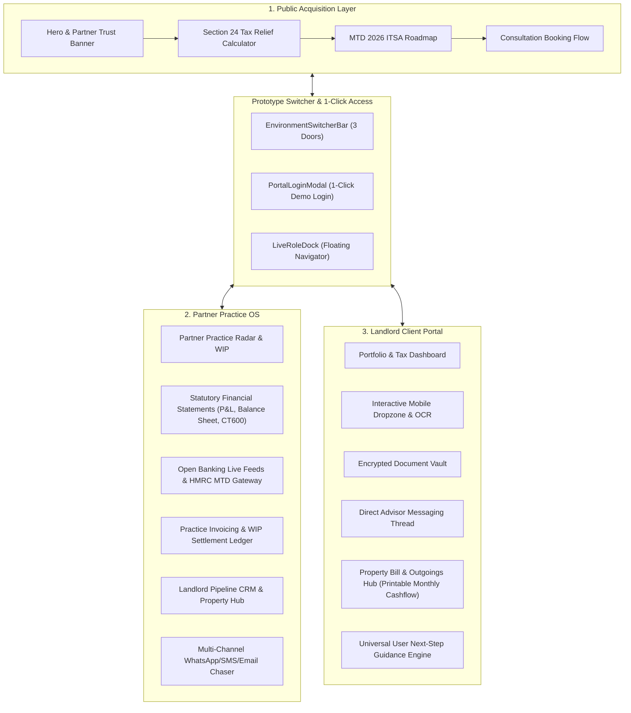

# KP Tax Consultants Ltd — Practice OS & Landlord Client Portal

A commercial demonstration platform and comprehensive operating system designed for **KP Tax Consultants Ltd** ([kptc.co.uk](https://www.kptc.co.uk/)). Engineered to replace fragmented email chasing and legacy compliance tools with an integrated client acquisition storefront, partner practice management OS, statutory accounting engine, and an intuitive, mobile-first client document dropzone.

---

## 🌟 Executive Overview

**KP Tax Consultants Ltd** (regulated by **ICAEW** & **CIOT**) specialises in UK property tax advisory, Section 24 portfolio restructuring, smart company incorporations, and owner-managed business compliance under Senior Partners **Kalpesh Patel BSc(Hons), FCA** and **Pritpal Chaggar BSc(Hons), ATT, CTA**.

This platform unifies three core environments:
1. **Public Practice Acquisition Storefront**: High-conversion landing experience featuring an interactive Section 24 Landlord Tax Relief Calculator, verified case studies, partner credentials, MTD for ITSA guidance, and direct consultation booking.
2. **Accountant Practice OS**: Partner command cockpit equipped with the Partner Practice Radar, Statutory Financial Statements (P&L & Balance Sheet), CT600 Marginal Relief Corporation Tax calculator, Open Banking live feeds, Practice Invoicing & WIP Ledger, Landlord Pipeline CRM, and automated Multi-Channel Chasers (WhatsApp/SMS/Email).
3. **Dedicated Landlord Client Portal**: Frictionless client portal with real-time tax liability tracking, encrypted document vault, direct advisor messaging, and an OCR Mobile Dropzone with simulated 375px phone camera capture.

---

## 🚀 Prototype Review Mode & Multi-Client Switching

For partner evaluation and stakeholder reviews, the platform includes a **1-click frictionless Prototype Mode** with dynamic, bidirectional client switching:
- **Master Cockpit Switcher (`EnvironmentSwitcherBar`)**: Persistent top header enabling immediate 1-tap switching between:
  1. *1. Public Practice Portal* (`kptc.co.uk` storefront, Section 24 calculator, MTD guidance)
  2. *2. Partner Practice OS* (Senior Partner Cockpit, Kalpesh Patel FCA & Pritpal Chaggar CTA)
  3. *3. Landlord Dropzone & Vault* (Singh Family BTL / Marcus Sterling)
- **Active Client Switching in BOTH Modes (`PortalSidebar`)**:
  - Available across Practice OS and the Landlord Client Portal with **0 refresh lag**.
  - Selecting another portfolio immediately updates:
    - Sidebar Active Portfolio Summary Card (structure, gross rent, assigned accountant, missing docs count).
    - Header account name and primary contact profile badge.
    - Statutory P&L and Balance Sheet recalculations in `FinancialStatementsHub`.
    - Document checklist, OCR dropzone, and encrypted vault records.
    - Contextual advisor messaging thread in `ClientMessages`.
  - In Practice OS: selecting a client while on global views (`radar`, `pipeline`) automatically transitions to the client's `Property & Owner Hub` (`workspace`) so the screen changes visibly and instantaneously.
- **1-Click Prototype Demo Access**: In `PortalLoginModal`, `/admin`, and `/portal`, reviewers can bypass manual password entry with a single tap on:
  - `⚡ Enter as Partner (Kalpesh Patel FCA)`
  - `⚡ Mum & Dad (Singh Family BTL - £16.8k Rental, Pritpal Chaggar CTA)`
  - `⚡ Marcus & Sarah Sterling (Sterling Property Holdings)`
- **Live Role Quick Dock (`LiveRoleDock`)**: Floating quick-view navigator allowing instant jumps to any of the 8 Practice OS tools or 4 Client Portal modules.

---

## 📊 Embedded Real Case Study: Singh Family Residential BTL (Parents)

Directly modeled on actual 2024/25 landlord tax records assigned to **Pritpal Chaggar CTA**:
- **Gross Rental Income**: £16,800.00 (£1,400.00 / month)
- **Allowable Property Expenses (£9,200.38 Total)**:
  - OpenRent Letting Management Fee: £120.00
  - Bathroom Refurbishment Contractor Invoice (Like-for-like repairs): £5,000.00
  - Freeholder Ground Rent: £294.00
  - Block Managing Agent Service Charge: £3,752.88
  - Local Authority Council Tax (April Void Period): £33.50
- **Net Operating Profit Before Finance Costs**: £7,599.62
- **Residential Finance Costs (Section 24 Restricted)**:
  - Annual Mortgage Interest: £6,330.72
  - Section 24 Basic Rate Tax Reducer (20%): £1,266.14
- **Encrypted Vault Storage**: All 6 statutory documents and invoices are catalogued with 256-bit signed preview URLs.

---

## 📱 Mobile Responsiveness & Viewport Immersion

- **Full-Screen Hamburger Navigation**: When the mobile navigation icon (hamburger) is tapped, the menu opens as a full-screen overlay (`z-[100]`) cleanly isolated from header backdrop filters.
- **Dual-Axis Viewport Scroll Locking**: Strict scroll freeze on `html.modal-open` and `body.modal-open` (`overflow: hidden !important; height: 100% !important; overscroll-behavior: none;`) ensures the background site never moves or drifts while menus or modals are open.
- **Fluid Drawer Architecture**: Portal navigation drawer uses fluid `overflow-y-auto overscroll-contain` layout with bottom safe-area insets (`pb-12`), eliminating vertical clipping on compact smartphones.
- **Touch-Friendly Hit Targets**: All buttons, navigation tabs, and select dropdowns meet or exceed WCAG 2.2 AA minimum standards (min 44×44px touch targets).
- **Responsive Accounting Tables**: All financial tables (P&L, Balance Sheet, Practice Invoices, Bank Feeds, and Landlord Pipeline) include horizontal momentum scrolling containers (`overflow-x-auto`) to display wide data sets cleanly on smartphones.

---

## 📐 Architecture & Key Modules



### Module Breakdown

#### 1. Statutory Financial Statements & Tax Modeling
- **Profit & Loss Statement (Income Statement):** Real-time breakdown of Gross Rental Income, Commercial Turnover, Allowable Expenses (Agent fees, repairs, insurance), Finance Costs, Corporation Tax liability, and Net Retained Profit.
- **Balance Sheet:** Tangible Fixed Assets (Property Portfolio value), Current Assets (Cash at bank, Debtors), Creditors falling due within one year (Mortgages, VAT liability, Corporation Tax), Long-term Liabilities, and Net Equity.
- **CT600 Corporation Tax Model:** Accurate calculations applying the 19% small profits rate (up to £50,000), marginal relief taper (between £50,000 and £250,000), and the 25% main rate.
- **Director Dividend vs Salary Optimization:** Remuneration modeling comparing optimal £12,570 salary + dividend allowance to minimize combined National Insurance and Corporation Tax.

#### 2. Open Banking Feeds & HMRC MTD ITSA Gateway
- **Live Multi-Bank Feeds:** Simulated live Open Banking transaction feeds for NatWest Commercial, Barclays SPV Corporate, and HSBC Premier accounts.
- **Automated Property Matching:** 1-click reconciliation matching transactions to specific properties and HMRC Self-Assessment / CT600 tax boxes.
- **Direct HMRC MTD XML Gateway:** Generates and downloads official XML schema payload compliant with HMRC Making Tax Digital for Income Tax Self Assessment (ITSA).

#### 3. Practice Invoicing & WIP Settlement Ledger
- Official UK VAT fee notes (£350 to £4,500 + 20% VAT) tied to client WIP balances.
- 1-click status transitions converting Unbilled WIP into Collected Practice Cash Flow.
- Printable PDF invoices formatted for UK statutory standards.

#### 4. Landlord Pipeline CRM & Multi-Channel Chaser
- Comprehensive stage tracking (Intake Submitted, KYC/AML Pending, Chasing Documents, Review Ready, Computation Complete).
- Automated multi-channel follow-ups (WhatsApp, SMS, Email) with pre-filled advisory templates.
- One-click CSV audit export for Xero Practice Manager and Karbon reconciliation.

#### 5. Landlord Property Bill & Outgoings Hub (Printable Cashflow)
- **Notion-Style Expense & Outgoings Hub**: Replaces paper binders with an integrated, printable monthly bill tracker.
- **HMRC Statutory Tax Splitting**: Automatically distinguishes 100% allowable property expenses (OpenRent letting fees, contractor bathroom refurbishment, ground rent, service charge, council tax void) from restricted Section 24 finance costs (mortgage payments).
- **1-Click Printable Statement (`window.print`)**: Tailored `@media print` layout producing clean, audit-ready monthly physical statements for landlord records.
- **Dynamic New Bill Logging**: Landlords and advisors can log ad-hoc contractor expenses with receipt attachments directly mapped to SA105 / CT600 boxes.

#### 6. Universal User Next-Step Guidance Engine (`UserNextStepBar`)
- Eliminates cognitive load across the entire platform by providing unambiguous next-action prompts (`Step 1 of 3: ...`) with statutory context and direct 1-click execution buttons on every module.

---

## 🎨 Design System & UX Standards

- **Color Palette**:
  - Primary Slate: `#0F172A` (Slate 900)
  - Accent / Growth: `#047857` (Emerald 700)
  - Amber / Warning: `#D97706` (Amber 600)
  - Surface Neutral: `#F8FAFC` (Slate 50)
  - Border Lines: `#E2E8F0` (Slate 200)
- **Layout Consistency**:
  - Strict 8px spacing grid.
  - Institutional card-only elevation (`accountant-card`), avoiding generic SaaS gradients.
  - Dual-axis viewport scroll locking on open overlays.
  - Safe-area insets (`pb-safe`) for edge-to-edge iOS displays.

---

## 🔍 SEO, AEO & Schema.org Metadata

- **Schema.org Structured Data**: Configured `AccountingService` JSON-LD in `app/layout.tsx` targeting UK search and AI Engine Optimization (AEO).
- **Official Entity Details (Verified via kptc.co.uk & Companies House)**:
  - **Company**: KP Tax Consultants Ltd (Company No. 12908850)
  - **Registered Office**: 167-169 Great Portland Street, 5th Floor, London, W1W 5PF, United Kingdom
  - **London Correspondence**: 7 Bell Yard, London, WC2A 2JR, United Kingdom
  - **Senior Leadership**:
    - **Kalpesh Patel** BSc (Hons), FCA (Fellow Chartered Accountant)
    - **Pritpal Singh Chaggar** BSc (Hons), ATT, CTA (Chartered Tax Advisor)
  - **Direct Contact**: `kpatel@kptc.co.uk` & `info@kptc.co.uk` | WhatsApp / Phone: `+44 7861 690954`
  - **Regulatory Bodies**: ICAEW (Institute of Chartered Accountants in England and Wales) & CIOT (Chartered Institute of Taxation)
  - **Core Practice Sectors**: Property Investors & Developers, Contractors & Freelancers (IR35), Construction Industry (CIS), Dentists & Healthcare, Retail, and E-commerce.

---

## 🛠️ Tech Stack

- **Framework**: [Next.js 14](https://nextjs.org/) (App Router, Static Exports ready)
- **Language**: [TypeScript](https://www.typescriptlang.org/) (Strict typing, 0 compile errors)
- **Styling**: [Tailwind CSS](https://tailwindcss.com/)
- **Icons**: [Lucide React](https://lucide.dev/)
- **Database / Cloud Sync**: [Supabase](https://supabase.com/) (PostgreSQL with Row Level Security)
- **State Management**: React Context Store with session storage persistence

---

## 🚀 Getting Started

### Prerequisites
- Node.js 18.17+ or higher
- npm, pnpm, or yarn

### Installation

```bash
# Clone the repository
git clone https://github.com/echelonsystemsgd-deep/uk-accountancy-os-prototype.git

# Enter repository directory
cd uk-accountancy-os-prototype

# Install dependencies
npm install
```

### Running Locally

```bash
npm run dev
```
Open [http://localhost:3000](http://localhost:3000) in your browser.

### Typecheck & Production Build

```bash
# Compile production build (verifies zero errors)
npm run build
```

---

## 📄 License & Attribution

Designed and engineered for **KP Tax Consultants Ltd** ([kptc.co.uk](https://www.kptc.co.uk/)). All brand rights, logos, and trademarks belong to their respective owners.
