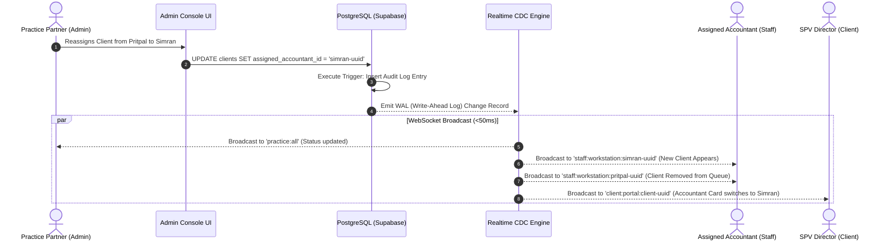

# Master Backend & Data Store Architecture Blueprint
### System: UK Accountancy Operating System & Practice Portal (Mercian & KP Tax Consultants)
### Target Infrastructure: Supabase (PostgreSQL 15, GoTrue Auth, Realtime CDC, Edge Functions, Private S3 Buckets)
### Author: Senior Software Architect & Lead Backend Systems Engineer

---

## 1. Executive Architecture & Mission

This document delivers the master backend, database, and state store architectural blueprint for the **UK Accountancy Operating System**. Engineered specifically for UK property SPVs (Special Purpose Vehicles), portfolio landlords, and chartered accountancy practices (**ICAEW & CIOT regulated**), this architecture resolves the three critical pillars of modern accounting practice technology:

1. **Role-Tailored Workstations:** Dedicated, tailored dashboards for **Practice Partners (Admin)**, **Assigned Accountants (Staff)**, and **Property SPV Directors (Clients)**.
2. **Instant Cross-Role Reactivity:** Real-time state synchronization via **PostgreSQL Change Data Capture (CDC) and WebSockets**, ensuring that whenever an admin reassigns a portfolio, approves a contractor invoice, or adjusts a statutory deadline, all connected staff and client screens reflect the mutation instantly with zero page reload.
3. **Institutional Security & UK Compliance:** Row-Level Security (RLS) on every table, `pgcrypto` field-level encryption for sensitive UK identifiers (UTR, NINO), private storage buckets with virus scanning webhooks, 6-year HMRC statutory retention, and an automated 90-day inactive user purge pipeline.

```
┌──────────────────────────────────────────────────────────────────────────────────────────────────┐
│                                    PRESENTATION LAYER (Next.js 14)                               │
├───────────────────────────────┬──────────────────────────────────┬───────────────────────────────┤
│   PARTNER COMMAND CENTER      │        STAFF WORKSTATION         │     CLIENT SPV VAULT          │
│   (/admin/dashboard)          │        (/workstation/dashboard)  │     (/portal/dashboard)       │
│   • Practice-wide KPIs (£18k) │        • Assigned Portfolios     │     • Section 24 Relief Live  │
│   • Master Client Directory   │        • Document Review Queue   │     • Tax-Free DLA (£134k)    │
│   • Staff Reassignment Matrix │        • Task Checklist Sign-Off │     • Dynamic Accountant Card │
│   • HMRC MTD Filing Gateway   │        • Direct Chat + Notes     │     • Direct Accountant Chat  │
└───────────────┬───────────────┴─────────────────┬────────────────┴───────────────┬───────────────┘
                │                                 │                                │
                ▼                                 ▼                                ▼
┌──────────────────────────────────────────────────────────────────────────────────────────────────┐
│                             API GATEWAY & EDGE SECURITY BOUNDARY                                 │
│    • Reverse Proxy & JWT Verification    • Upstash Distributed Rate Limiting (100 req/min)       │
│    • Role Gate Middleware (admin/staff/client) • TLS 1.3 Transport Layer Encryption              │
└─────────────────────────────────────────┬────────────────────────────────────────────────────────┘
                                          │
                                          ▼
┌──────────────────────────────────────────────────────────────────────────────────────────────────┐
│                               SUPABASE CLOUD (London eu-west-2)                                  │
├──────────────────────────────────────────────────────────────────────────────────────────────────┤
│ 1. GoTrue Auth: TOTP Multi-Factor Authentication (MFA), 30-min idle session timeout              │
│ 2. PostgreSQL 15 Engine: 14 Relational Tables, Foreign Keys, CHECK constraints                   │
│ 3. Row-Level Security (RLS): Policy isolation matrix enforcing tenant & staff boundaries        │
│ 4. pgcrypto Vault: Symmetric 256-bit AES encryption for UTR and National Insurance Numbers       │
│ 5. Realtime CDC Engine: Logical replication broadcasting row mutations to WebSockets (<50ms)     │
│ 6. Private Storage Buckets: Signed URLs (TTL: 900s), MIME whitelisting, 25MB limits              │
│ 7. Edge Functions (Deno): Resend transactional email, Twilio UK SMS, ClamAV virus scanning      │
└──────────────────────────────────────────────────────────────────────────────────────────────────┘
```

---

## 2. Complete Relational Database Schema (14 Production Tables)

The PostgreSQL 15 database is normalized to 3NF, utilizing UUIDv4 primary keys, UTC timestamps, and strict referential integrity.

### 2.1 Table 1: `practice_users` (Identity & Roles)
Maps to `auth.users` via 1:1 foreign key. Governs the 4 lifecycle roles: `user`, `client`, `staff`, and `admin`.

```sql
CREATE TYPE user_role AS ENUM ('user', 'client', 'staff', 'admin');
CREATE TYPE user_status AS ENUM ('active', 'suspended', 'banned', 'pending_verification');

CREATE TABLE practice_users (
    id UUID PRIMARY KEY REFERENCES auth.users(id) ON DELETE CASCADE,
    email TEXT NOT NULL UNIQUE,
    full_name TEXT NOT NULL,
    role user_role NOT NULL DEFAULT 'user',
    status user_status NOT NULL DEFAULT 'pending_verification',
    phone TEXT,
    avatar_url TEXT,
    mfa_enabled BOOLEAN NOT NULL DEFAULT false,
    banned_reason TEXT,
    banned_at TIMESTAMPTZ,
    banned_by UUID REFERENCES practice_users(id),
    terms_accepted_at TIMESTAMPTZ,
    privacy_accepted_at TIMESTAMPTZ,
    last_login_at TIMESTAMPTZ,
    created_at TIMESTAMPTZ NOT NULL DEFAULT NOW(),
    updated_at TIMESTAMPTZ NOT NULL DEFAULT NOW()
);

CREATE INDEX idx_practice_users_role ON practice_users(role);
CREATE INDEX idx_practice_users_status ON practice_users(status);
```

### 2.2 Table 2: `clients` (Master Practice Clients)
Represents the client engagement container (individuals or corporate landlord groups).

```sql
CREATE TYPE client_stage AS ENUM (
    'intake_submitted',
    'kyc_pending',
    'chasing_docs',
    'review_ready',
    'computation_complete',
    'filed_retained'
);

CREATE TABLE clients (
    id UUID PRIMARY KEY DEFAULT gen_random_uuid(),
    entity_name TEXT NOT NULL,
    entity_type TEXT NOT NULL CHECK (entity_type IN ('spv_ltd', 'individual', 'joint', 'partnership')),
    company_number VARCHAR(12),
    vat_number VARCHAR(15),
    primary_contact_name TEXT NOT NULL,
    primary_email TEXT NOT NULL,
    primary_phone TEXT NOT NULL,
    stage client_stage NOT NULL DEFAULT 'intake_submitted',
    assigned_accountant_id UUID REFERENCES practice_users(id) ON DELETE SET NULL,
    unbilled_wip_pence BIGINT NOT NULL DEFAULT 0,
    annual_turnover_pence BIGINT NOT NULL DEFAULT 0,
    retention_purge_date TIMESTAMPTZ NOT NULL DEFAULT (NOW() + INTERVAL '6 years'),
    last_interaction_at TIMESTAMPTZ NOT NULL DEFAULT NOW(),
    is_inactive_alert_sent BOOLEAN NOT NULL DEFAULT false,
    created_at TIMESTAMPTZ NOT NULL DEFAULT NOW(),
    updated_at TIMESTAMPTZ NOT NULL DEFAULT NOW()
);

CREATE INDEX idx_clients_stage ON clients(stage);
CREATE INDEX idx_clients_assigned_accountant ON clients(assigned_accountant_id);
```

### 2.3 Table 3: `client_parties` (Directors, Shareholders & Encrypted Tax IDs)
Stores individuals connected to the entity. Sensitive UK tax identifiers (UTR, NINO) are stored encrypted via `pgcrypto`.

```sql
CREATE TABLE client_parties (
    id UUID PRIMARY KEY DEFAULT gen_random_uuid(),
    client_id UUID NOT NULL REFERENCES clients(id) ON DELETE CASCADE,
    user_id UUID REFERENCES practice_users(id) ON DELETE SET NULL,
    full_name TEXT NOT NULL,
    role_description TEXT NOT NULL, -- e.g. "Managing Director & 100% Shareholder"
    email TEXT NOT NULL,
    phone TEXT,
    -- Encrypted bytea storage using practice secret key
    encrypted_utr BYTEA,
    encrypted_nino BYTEA,
    id_verified BOOLEAN NOT NULL DEFAULT false,
    id_verified_at TIMESTAMPTZ,
    address_verified BOOLEAN NOT NULL DEFAULT false,
    created_at TIMESTAMPTZ NOT NULL DEFAULT NOW()
);

CREATE INDEX idx_client_parties_client ON client_parties(client_id);
```

### 2.4 Table 4: `spv_companies` (Companies House Registry Sync)
Holds Companies House corporate metadata and statutory filing clocks.

```sql
CREATE TABLE spv_companies (
    id UUID PRIMARY KEY DEFAULT gen_random_uuid(),
    client_id UUID NOT NULL REFERENCES clients(id) ON DELETE CASCADE,
    company_name TEXT NOT NULL,
    crn VARCHAR(10) NOT NULL UNIQUE,
    incorporation_date DATE NOT NULL,
    sic_code VARCHAR(10) NOT NULL DEFAULT '68209', -- Other letting/operating of own real estate
    accounting_reference_date VARCHAR(5) NOT NULL, -- e.g. "03-31"
    next_accounts_due DATE NOT NULL,
    next_confirmation_statement_due DATE NOT NULL,
    micro_entity_frs105_eligible BOOLEAN NOT NULL DEFAULT true,
    companies_house_auth_code_encrypted BYTEA,
    created_at TIMESTAMPTZ NOT NULL DEFAULT NOW()
);

CREATE INDEX idx_spv_crn ON spv_companies(crn);
```

### 2.5 Table 5: `properties` (Asset Register & Valuation Basis)
Underpins Section 24 finance cost deductions, Land Registry indexing, and CGT base cost tracking.

```sql
CREATE TABLE properties (
    id UUID PRIMARY KEY DEFAULT gen_random_uuid(),
    client_id UUID NOT NULL REFERENCES clients(id) ON DELETE CASCADE,
    spv_id UUID REFERENCES spv_companies(id) ON DELETE SET NULL,
    address_line TEXT NOT NULL,
    postcode VARCHAR(10) NOT NULL,
    property_type TEXT NOT NULL, -- 'Residential BTL', 'HMO', 'Commercial'
    ownership_split TEXT NOT NULL DEFAULT '100% SPV Ltd',
    annual_rental_income_pence BIGINT NOT NULL DEFAULT 0,
    mortgage_lender TEXT NOT NULL,
    outstanding_mortgage_pence BIGINT NOT NULL DEFAULT 0,
    purchase_date DATE NOT NULL,
    purchase_price_pence BIGINT NOT NULL,
    current_valuation_pence BIGINT NOT NULL,
    deposit_paid_pence BIGINT NOT NULL,
    stamp_duty_paid_pence BIGINT NOT NULL,
    legal_fees_pence BIGINT NOT NULL,
    monthly_mortgage_payment_pence BIGINT NOT NULL,
    monthly_mortgage_interest_pence BIGINT NOT NULL,
    is_spv_held BOOLEAN NOT NULL DEFAULT true,
    net_yield_pct NUMERIC(5, 2) NOT NULL DEFAULT 0.00,
    created_at TIMESTAMPTZ NOT NULL DEFAULT NOW()
);

CREATE INDEX idx_properties_client ON properties(client_id);
```

### 2.6 Table 6: `leases_tenancies` (AST Tenancy Agreements)
Connects rental income debits to verified contracts.

```sql
CREATE TABLE leases_tenancies (
    id UUID PRIMARY KEY DEFAULT gen_random_uuid(),
    property_id UUID NOT NULL REFERENCES properties(id) ON DELETE CASCADE,
    tenant_full_name TEXT NOT NULL,
    monthly_rent_pence BIGINT NOT NULL,
    deposit_amount_pence BIGINT NOT NULL,
    tenancy_deposit_scheme_ref TEXT,
    tenancy_start_date DATE NOT NULL,
    tenancy_end_date DATE NOT NULL,
    is_active BOOLEAN NOT NULL DEFAULT true,
    created_at TIMESTAMPTZ NOT NULL DEFAULT NOW()
);

CREATE INDEX idx_leases_property ON leases_tenancies(property_id);
```

### 2.7 Table 7: `nominal_transactions` (Chart of Accounts Ledger)
Core engine for Section 24 and MTD ITSA nominal classification.

```sql
CREATE TYPE transaction_type AS ENUM ('credit', 'debit');
CREATE TYPE nominal_status AS ENUM ('unreconciled', 'matched', 'flagged', 'locked_to_ledger');

CREATE TABLE nominal_transactions (
    id UUID PRIMARY KEY DEFAULT gen_random_uuid(),
    client_id UUID NOT NULL REFERENCES clients(id) ON DELETE CASCADE,
    property_id UUID REFERENCES properties(id) ON DELETE SET NULL,
    transaction_date DATE NOT NULL,
    bank_name TEXT NOT NULL,
    bank_account_tail VARCHAR(4) NOT NULL,
    statement_description TEXT NOT NULL,
    amount_pence BIGINT NOT NULL,
    tx_type transaction_type NOT NULL,
    nominal_code VARCHAR(10) NOT NULL, -- e.g. "7100" (Finance Cost), "7200" (Repairs), "4000" (Rent)
    nominal_category TEXT NOT NULL,
    vat_rate_pct NUMERIC(4, 2) NOT NULL DEFAULT 0.00,
    vat_amount_pence BIGINT NOT NULL DEFAULT 0,
    is_section24_allowable BOOLEAN NOT NULL DEFAULT true,
    status nominal_status NOT NULL DEFAULT 'matched',
    confidence_score NUMERIC(4, 3) NOT NULL DEFAULT 0.990,
    hmrc_audit_hash TEXT NOT NULL,
    created_at TIMESTAMPTZ NOT NULL DEFAULT NOW()
);

CREATE INDEX idx_nominal_client_date ON nominal_transactions(client_id, transaction_date DESC);
CREATE INDEX idx_nominal_code ON nominal_transactions(nominal_code);
```

### 2.8 Table 8: `dla_ledger` (Director's Loan Account Architecture)
Enforces the 100% tax-free extraction schedule and protects against Section 455 (33.75% tax penalty) overdrawn loans.

```sql
CREATE TYPE dla_category AS ENUM (
    'deposit_equity',
    'conveyancing_capital',
    'personal_card_expense',
    'mileage_recharge',
    'director_cash_drawing',
    'dividend_adjustment'
);

CREATE TABLE dla_ledger (
    id UUID PRIMARY KEY DEFAULT gen_random_uuid(),
    client_id UUID NOT NULL REFERENCES clients(id) ON DELETE CASCADE,
    party_id UUID REFERENCES client_parties(id) ON DELETE SET NULL,
    reference_property_id UUID REFERENCES properties(id) ON DELETE SET NULL,
    entry_date DATE NOT NULL,
    description TEXT NOT NULL,
    credit_pence BIGINT NOT NULL DEFAULT 0, -- Director funds company (Extraction Pool increases)
    debit_pence BIGINT NOT NULL DEFAULT 0,  -- Director extracts cash (Extraction Pool decreases)
    category dla_category NOT NULL,
    running_balance_pence BIGINT NOT NULL,
    is_s455_risk BOOLEAN NOT NULL DEFAULT false, -- Set true if running balance becomes negative (overdrawn)
    verified_by_accountant_id UUID REFERENCES practice_users(id),
    created_at TIMESTAMPTZ NOT NULL DEFAULT NOW()
);

CREATE INDEX idx_dla_client ON dla_ledger(client_id, entry_date DESC);
```

### 2.9 Table 9: `mileage_logs` (HMRC Statutory Mileage Allowance)
Automates 45p/mile claims with instant credit into the Director's Loan Account.

```sql
CREATE TABLE mileage_logs (
    id UUID PRIMARY KEY DEFAULT gen_random_uuid(),
    client_id UUID NOT NULL REFERENCES clients(id) ON DELETE CASCADE,
    property_id UUID REFERENCES properties(id) ON DELETE SET NULL,
    journey_date DATE NOT NULL,
    start_postcode VARCHAR(10) NOT NULL,
    end_postcode VARCHAR(10) NOT NULL,
    business_purpose TEXT NOT NULL, -- e.g. "Tenant inspection & inventory check"
    miles_claimed NUMERIC(7, 2) NOT NULL,
    rate_pence_per_mile INT NOT NULL DEFAULT 45,
    total_claim_pence BIGINT NOT NULL,
    dla_credited BOOLEAN NOT NULL DEFAULT false,
    dla_entry_id UUID REFERENCES dla_ledger(id) ON DELETE SET NULL,
    created_at TIMESTAMPTZ NOT NULL DEFAULT NOW()
);

CREATE INDEX idx_mileage_client ON mileage_logs(client_id);
```

### 2.10 Table 10: `documents` & `document_reviews` (Private Vault & Scan Records)
Stores file metadata in Supabase Private Storage with ClamAV virus-scan certification.

```sql
CREATE TYPE doc_status AS ENUM ('requested', 'uploaded', 'verified', 'rejected');
CREATE TYPE doc_category AS ENUM ('mortgage_statement', 'contractor_invoice', 'tenancy_ast', 'id_aml', 'completion_statement', 'other');

CREATE TABLE documents (
    id UUID PRIMARY KEY DEFAULT gen_random_uuid(),
    client_id UUID NOT NULL REFERENCES clients(id) ON DELETE CASCADE,
    storage_path TEXT NOT NULL UNIQUE, -- Private bucket path: e.g. "clients/{id}/statements/{uuid}.pdf"
    file_name TEXT NOT NULL,
    file_size_bytes BIGINT NOT NULL,
    mime_type TEXT NOT NULL,
    category doc_category NOT NULL,
    status doc_status NOT NULL DEFAULT 'requested',
    virus_scan_status TEXT NOT NULL DEFAULT 'clean_clamav',
    sha256_hash TEXT NOT NULL,
    uploaded_at TIMESTAMPTZ,
    verified_at TIMESTAMPTZ,
    rejection_reason TEXT,
    reviewed_by_id UUID REFERENCES practice_users(id),
    created_at TIMESTAMPTZ NOT NULL DEFAULT NOW()
);

CREATE INDEX idx_documents_client_status ON documents(client_id, status);
```

### 2.11 Table 11: `statutory_deadlines` (Configurable Tax Milestones)
Practice-wide deadline manager. Dates are fully configurable and never hardcoded.

```sql
CREATE TYPE deadline_status AS ENUM ('pending', 'in_progress', 'draft_prepared', 'filed_accepted', 'overdue');

CREATE TABLE statutory_deadlines (
    id UUID PRIMARY KEY DEFAULT gen_random_uuid(),
    client_id UUID NOT NULL REFERENCES clients(id) ON DELETE CASCADE,
    title TEXT NOT NULL, -- e.g. "CT600 Corporation Tax Filing 2024/25"
    due_date DATE NOT NULL,
    assigned_staff_id UUID REFERENCES practice_users(id) ON DELETE SET NULL,
    status deadline_status NOT NULL DEFAULT 'pending',
    is_statutory BOOLEAN NOT NULL DEFAULT true,
    checklist_items JSONB NOT NULL DEFAULT '[]'::JSONB, -- Array of sub-tasks
    hmrc_confirmation_code TEXT,
    created_at TIMESTAMPTZ NOT NULL DEFAULT NOW(),
    updated_at TIMESTAMPTZ NOT NULL DEFAULT NOW()
);

CREATE INDEX idx_deadlines_due_date ON statutory_deadlines(due_date ASC);
```

### 2.12 Table 12: `practice_invoices` (Statement of Account - Reference Only)
Tracks work-in-progress and billing fee notes. No payments inside the app; Stripe schema-ready.

```sql
CREATE TYPE invoice_status AS ENUM ('draft', 'issued', 'paid', 'overdue', 'cancelled');

CREATE TABLE practice_invoices (
    id UUID PRIMARY KEY DEFAULT gen_random_uuid(),
    client_id UUID NOT NULL REFERENCES clients(id) ON DELETE CASCADE,
    invoice_number VARCHAR(20) NOT NULL UNIQUE,
    issue_date DATE NOT NULL,
    due_date DATE NOT NULL,
    net_amount_pence BIGINT NOT NULL,
    vat_amount_pence BIGINT NOT NULL DEFAULT 0,
    gross_amount_pence BIGINT NOT NULL,
    description TEXT NOT NULL,
    status invoice_status NOT NULL DEFAULT 'issued',
    external_stripe_payment_intent_id TEXT, -- Reserved for future payment integration
    paid_at TIMESTAMPTZ,
    created_at TIMESTAMPTZ NOT NULL DEFAULT NOW()
);

CREATE INDEX idx_invoices_client ON practice_invoices(client_id);
```

### 2.13 Table 13: `communication_threads` & `messages` (Accountant Chat)
Real-time threaded chat between clients and assigned accountants, with segregated internal staff notes.

```sql
CREATE TABLE communication_threads (
    id UUID PRIMARY KEY DEFAULT gen_random_uuid(),
    client_id UUID NOT NULL REFERENCES clients(id) ON DELETE CASCADE,
    subject TEXT NOT NULL,
    last_message_at TIMESTAMPTZ NOT NULL DEFAULT NOW(),
    created_at TIMESTAMPTZ NOT NULL DEFAULT NOW()
);

CREATE TABLE messages (
    id UUID PRIMARY KEY DEFAULT gen_random_uuid(),
    thread_id UUID NOT NULL REFERENCES communication_threads(id) ON DELETE CASCADE,
    sender_id UUID NOT NULL REFERENCES practice_users(id) ON DELETE CASCADE,
    body TEXT NOT NULL,
    attachment_doc_id UUID REFERENCES documents(id) ON DELETE SET NULL,
    is_internal_note BOOLEAN NOT NULL DEFAULT false, -- Hidden from clients via RLS
    is_read BOOLEAN NOT NULL DEFAULT false,
    created_at TIMESTAMPTZ NOT NULL DEFAULT NOW()
);

CREATE INDEX idx_messages_thread ON messages(thread_id, created_at ASC);
```

### 2.14 Table 14: `immutable_audit_logs` (Append-Only Compliance Trail)
ICAEW / CIOT compliant append-only ledger tracking all authentication, data mutations, and role elevation.

```sql
CREATE TABLE immutable_audit_logs (
    id UUID PRIMARY KEY DEFAULT gen_random_uuid(),
    actor_id UUID REFERENCES practice_users(id) ON DELETE SET NULL,
    actor_email TEXT NOT NULL,
    actor_role user_role NOT NULL,
    action_type TEXT NOT NULL, -- e.g. "CLIENT_REASSIGNED", "DOC_ACCEPTED", "LOGIN_SUCCESS"
    target_table TEXT NOT NULL,
    target_record_id UUID,
    previous_state JSONB,
    new_state JSONB,
    ip_address INET,
    user_agent TEXT,
    created_at TIMESTAMPTZ NOT NULL DEFAULT NOW()
);

-- Strict Rule: No UPDATE or DELETE permits on audit trail
CREATE INDEX idx_audit_created ON immutable_audit_logs(created_at DESC);
```

---

## 3. Real-Time Synchronization Engine (Supabase CDC & WebSockets)

A critical requirement of the system is that **when an admin performs any operation, staff and clients immediately see the updates without page refresh**.

### 3.1 Logical Replication & Channel Topology



### 3.2 Realtime Publication Configuration
Enable logical replication on dynamic tables:

```sql
ALTER PUBLICATION supabase_realtime ADD TABLE clients;
ALTER PUBLICATION supabase_realtime ADD TABLE documents;
ALTER PUBLICATION supabase_realtime ADD TABLE statutory_deadlines;
ALTER PUBLICATION supabase_realtime ADD TABLE dla_ledger;
ALTER PUBLICATION supabase_realtime ADD TABLE messages;
ALTER PUBLICATION supabase_realtime ADD TABLE practice_invoices;
```

### 3.3 Dynamic Front-End Listener Hook (`usePracticeRealtimeSync`)

```typescript
// lib/hooks/usePracticeRealtimeSync.ts
import { useEffect } from "react";
import { supabase } from "@/lib/supabaseClient";
import { useDemo } from "@/lib/store";

export function usePracticeRealtimeSync(role: "admin" | "staff" | "client", entityId?: string) {
  const { reassignClientStaff, verifyBillOrDocument, triggerToast } = useDemo();

  useEffect(() => {
    // 1. Listen for Client Reassignment & Lifecycle Status Mutations
    const clientChannel = supabase
      .channel("public:clients")
      .on(
        "postgres_changes",
        { event: "UPDATE", schema: "public", table: "clients" },
        (payload) => {
          const updated = payload.new;
          reassignClientStaff(updated.id, updated.assigned_accountant_name);
          triggerToast(
            "Portfolio Reassigned",
            `${updated.entity_name} lead accountant updated in real-time.`,
            "info"
          );
        }
      )
      .subscribe();

    // 2. Listen for Document Verification Events
    const docChannel = supabase
      .channel("public:documents")
      .on(
        "postgres_changes",
        { event: "UPDATE", schema: "public", table: "documents" },
        (payload) => {
          const doc = payload.new;
          if (doc.status === "verified") {
            verifyBillOrDocument(doc.client_id, doc.id, "document");
            triggerToast("Document Verified", `${doc.file_name} signed off by partner.`, "success");
          }
        }
      )
      .subscribe();

    return () => {
      supabase.removeChannel(clientChannel);
      supabase.removeChannel(docChannel);
    };
  }, [role, entityId]);
}
```

---

## 4. Row-Level Security (RLS) Policy Matrix

PostgreSQL RLS ensures that database queries are isolated at the database engine level, making unauthorized access physically impossible.

| Table | `anon` (Unauthenticated) | `user` (Unengaged) | `client` (Portfolio Landlord) | `staff` (Assigned Accountant) | `admin` (Practice Partner) |
| :--- | :---: | :---: | :---: | :---: | :---: |
| `practice_users` | No Access | Read Self | Read Self & Assigned Staff | Read Assigned Clients & Staff | **Full CRUD Access** |
| `clients` | No Access | No Access | Read Assigned Entity (`id = client_id`) | Read Assigned Only (`assigned_accountant_id = uid`) | **Full CRUD Access** |
| `client_parties` | No Access | No Access | Read/Update Self | Read Assigned Clients | **Full CRUD Access** |
| `properties` | No Access | No Access | Full Access for Own Client | Full Access for Assigned Clients | **Full CRUD Access** |
| `nominal_transactions`| No Access | No Access | Read Own SPV Ledger | Full Access for Assigned Clients | **Full CRUD Access** |
| `dla_ledger` | No Access | No Access | Read Own DLA Balance & Statements | Full Access for Assigned Clients | **Full CRUD Access** |
| `documents` | No Access | No Access | Read & Upload to Own Vault | Read & Review Assigned Clients | **Full CRUD Access** |
| `messages` | No Access | No Access | Read/Send in Thread (`is_internal = false`) | Read/Send All in Assigned Thread | **Full Access** |
| `immutable_audit_logs`| No Access | No Access | No Access | No Access | **Read Only (Append-Only Triggers)** |

### 4.1 SQL RLS Policy Implementation Examples

```sql
-- Enable RLS across all tables
ALTER TABLE clients ENABLE ROW LEVEL SECURITY;
ALTER TABLE documents ENABLE ROW LEVEL SECURITY;
ALTER TABLE messages ENABLE ROW LEVEL SECURITY;

-- 1. Staff Client Isolation Policy (Staff only sees assigned clients)
CREATE POLICY staff_assigned_clients_policy ON clients
    FOR SELECT
    USING (
        (auth.jwt() ->> 'role' = 'staff' AND assigned_accountant_id = auth.uid())
        OR (auth.jwt() ->> 'role' = 'admin')
    );

-- 2. Client Self-Access Policy
CREATE POLICY client_own_entity_policy ON clients
    FOR SELECT
    USING (
        auth.jwt() ->> 'role' = 'client' 
        AND id = (auth.jwt() ->> 'client_id')::UUID
    );

-- 3. Internal Practice Note Masking Policy (Clients cannot see staff internal notes)
CREATE POLICY client_messages_mask_internal ON messages
    FOR SELECT
    USING (
        (is_internal_note = false AND thread_id IN (
            SELECT id FROM communication_threads WHERE client_id = (auth.jwt() ->> 'client_id')::UUID
        ))
        OR (auth.jwt() ->> 'role' IN ('staff', 'admin'))
    );
```

---

## 5. Security, Cryptography & Compliance Hardening

### 5.1 Field-Level Encryption (`pgcrypto`)
UK Tax Identifiers (Unique Taxpayer Reference `UTR` and National Insurance Number `NINO`) must never exist in plaintext in Postgres tables or database backups.

```sql
CREATE EXTENSION IF NOT EXISTS pgcrypto;

-- Encryption Function using Vault Secret Key
CREATE OR REPLACE FUNCTION encrypt_sensitive_tax_id(raw_text TEXT, master_key TEXT)
RETURNS BYTEA AS $$
BEGIN
    RETURN pgp_sym_encrypt(raw_text, master_key);
END;
$$ LANGUAGE plpgsql SECURITY DEFINER;

-- Decryption Function restricted to verified partners
CREATE OR REPLACE FUNCTION decrypt_sensitive_tax_id(encrypted_data BYTEA, master_key TEXT)
RETURNS TEXT AS $$
BEGIN
    RETURN pgp_sym_decrypt(encrypted_data, master_key);
END;
$$ LANGUAGE plpgsql SECURITY DEFINER;
```

### 5.2 Private Storage Buckets with Signed URLs
1. **Private Buckets:** `spv-vault` bucket configured as private. Direct public access is disabled.
2. **Access Control:** All document downloads use **Signed URLs** generated on-the-fly with a **900-second (15-minute) Time-To-Live (TTL)**.
3. **Upload Constraints:** Max upload size 25MB. MIME types whitelisted to `application/pdf`, `image/png`, `image/jpeg`.

### 5.3 Asynchronous Malware & Antivirus Scanning Pipeline
- When a document is uploaded to the private bucket, a Supabase Database Webhook fires an edge function:
  1. Downloads the file stream into an isolated container sandbox.
  2. Runs **ClamAV / VirusTotal REST check**.
  3. If clean: sets `virus_scan_status = 'clean_clamav'` and unlocks the document.
  4. If infected: deletes the file immediately, sets `status = 'rejected'`, logs an alert in `immutable_audit_logs`, and emails the practice security team.

### 5.4 Statutory 6-Year Retention & 90-Day Inactive User Purge
1. **6-Year Statutory Retention:** Tax records, balance sheets, and DLA ledgers have `retention_purge_date` calculated as `NOW() + INTERVAL '6 years'`. RLS and database triggers prevent purging of any financial ledger before this date.
2. **90-Day Unverified Inactive Lead Purge:** Unverified users with no active consultation or signed engagement are run through an automated escalation cron (`check_inactive_leads`):
   - **Day 30:** Automated WhatsApp message & Email requesting confirmation of interest.
   - **Day 60:** Second notification warning of upcoming data purge under UK GDPR Principle (e) Storage Limitation.
   - **Day 90:** If unverified and no response received, the record and associated personal data are permanently purged.

---

## 6. Notification & Third-Party Edge Functions

```
┌────────────────────────────────────────────────────────────────────────┐
│                      EDGE FUNCTIONS SUITE (Deno)                       │
├─────────────────────────┬──────────────────────┬───────────────────────┤
│ 1. send-resend-email    │ 2. send-twilio-sms   │ 3. whatsapp-chaser    │
│ • Booking confirmation  │ • Urgent 48h filing  │ • Missing AST chaser  │
│ • Document request      │ • 1h meeting alert   │ • Direct link upload  │
│ • 90-day retention warn │ • MFA OTP delivery   │ • Read receipt hook   │
└─────────────────────────┴──────────────────────┴───────────────────────┘
```

### 6.1 Resend Transactional Email Engine
- **Provider:** Resend.
- **Templates:** Standardized HTML templates with British Forest Green branding (`#0c1813`) and high-density typography.

### 6.2 Twilio UK Verified SMS Gateway
- **Provider:** Twilio UK using registered Alphanumeric Sender ID (`MERCIAN` / `KPTC`).
- **Use Cases:** Time-sensitive statutory deadline warnings (48h to statutory filing deadline) and one-time MFA codes.

### 6.3 WhatsApp Business Cloud API Chaser Workflow
- Automated sequence triggering when `missingDocumentsCount > 0`:
  - Directly pings landlord WhatsApp with the list of missing items (e.g. *"Paragon Bank Statement Q4"*).
  - Supplies a one-click magic link into the encrypted upload dropzone.

---

## 7. Frontend State Architecture (`lib/store.tsx`)

The frontend prototype is orchestrated by a reactive state store (`useDemoStore` / `DemoProvider`) that models this backend architecture in-memory:

1. **State Isolation:** Holds master client entities, property units, nominal ledger streams, DLA transactions, invoices, and audit logs.
2. **Dynamic Staff & Partner Perspectives:**
   - **Partner Mode (`currentStaffPerspective = null`):** Displays practice-wide overview, total £18.4k WIP, all 14 client portfolios, and full reassignment capability.
   - **Staff Mode (`currentStaffPerspective = 'Simran Kaur ACA'`):** Dynamically filters client lists and pending document queues to show only assigned portfolios.
3. **Reactive Reassignment Action (`reassignClientStaff`):**
   - Mutates `c.assignedAccountant = newStaff`.
   - Triggers an instantaneous re-render across the admin matrix and dynamically updates the client portal header badge to display the new accountant's name and credentials.
4. **Zero-Jump Scroll Lock Hook (`useScrollLock`):**
   - Preserves window scroll position with zero layout shift when opening modals or drawers.

---

## 8. Summary of Implementation Milestones

| Milestone | Deliverables & Scope |
| :--- | :--- |
| **Phase 1: Database DDL & Schema** | Execute SQL migration for 14 tables, foreign keys, CHECK constraints, and indexes. |
| **Phase 2: RLS Matrix & Encryption** | Apply Row-Level Security policies per role, configure `pgcrypto` field-level encryption. |
| **Phase 3: Storage & Virus Scanner** | Set up private `spv-vault` bucket, configure signed URL edge functions, and integrate ClamAV. |
| **Phase 4: Realtime CDC Hookup** | Subscribe client and workstation UIs to PostgreSQL logical replication change streams. |
| **Phase 5: Notification Services** | Connect Resend email templates, Twilio SMS webhooks, and WhatsApp chaser flows. |
| **Phase 6: Inactivity Purge Cron** | Deploy pg_cron / Edge Function for 90-day inactive lead purge and 6-year retention defense. |
