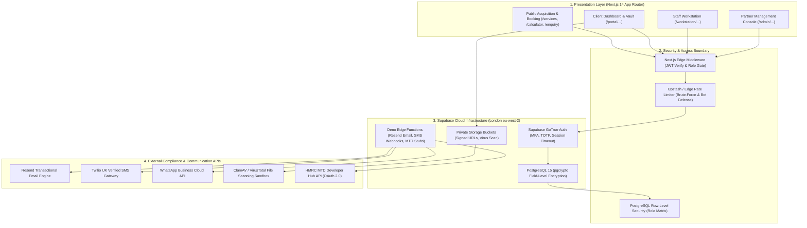
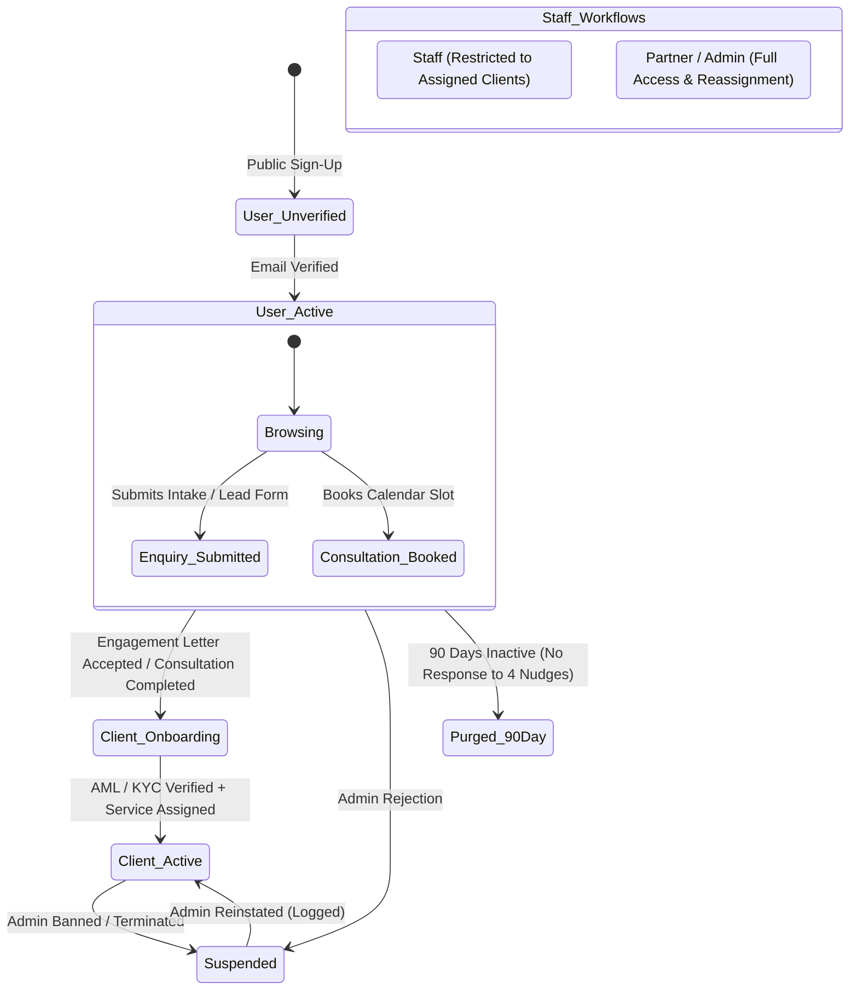
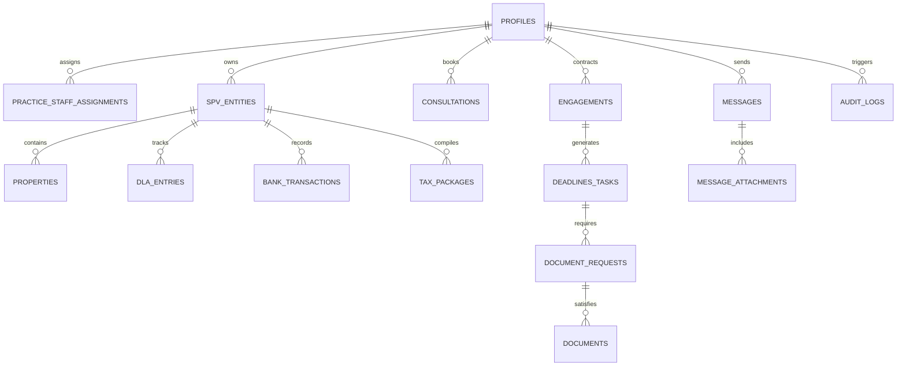

# Comprehensive Backend & Dashboard Architecture Implementation Plan
### Project: UK Accountancy Operating System & Practice Portal
### Practice Authority: KP Tax Consultants (ICAEW & CIOT Regulated) | Mercian Wealth
### Target Branch: `feat/accountancy-backend-plan`
### Author: Senior Software Architect & Lead Systems Engineer

---

## Executive Summary

This document specifies the complete architectural, database, security, and dashboard implementation plan for upgrading the **UK Accountancy OS** into a multi-tenant, production-grade practice operating system. 

The architecture is built on **Supabase (PostgreSQL, Auth, Edge Functions, and Private Storage)**, strictly adhering to **UK GDPR**, **ICAEW / CIOT compliance regulations**, and **HMRC Making Tax Digital (MTD)** data integrity standards.

---

## 1. Architectural Overview & Topology



---

## 2. Roles & User Lifecycle State Machine

The platform strictly differentiates between unengaged signups, contracted clients, assigned staff, and practice equity partners.



### Detailed Role Definitions:
1. **`user`**:
   - Initial state upon registration.
   - Access limited to public calculators, profile settings, and viewing pending consultation bookings.
   - **No access** to the full accounting ledger, document vault, or accountant chat.
   - Automatically transitions to `client` when an enquiry is accepted or a formal consultation booking is confirmed.
2. **`client`**:
   - Created when a user accepts an engagement or books a consultation.
   - Full access to their dedicated client dashboard (`/portal/dashboard`), document upload center, Section 24 property ledger, DLA tracker, appointment calendar, and chat thread with their assigned accountant.
3. **`staff`**:
   - Practice accountants and assistant bookkeepers.
   - **Strict Isolation Rule:** Can *only* view, review, chat with, and edit clients **explicitly assigned** to them in `practice_staff_assignments`.
   - Access to tasks, deadlines calendar, document review queue, and internal notes for their assigned roster.
4. **`admin`**:
   - Senior Partners (Kalpesh Patel FCA, Pritpal Chaggar CTA) and Practice Directors.
   - Unrestricted access: Can view all clients, override assignments, manage billing, configure services/pricing, inspect immutable audit logs, and ban/reinstate users.

### Ban & Rejection Lifecycle:
- Every account suspension, rejection, or ban requires an administrative `reason_code` and `reason_notes`.
- Sets `is_banned = true`, `banned_at = NOW()`, `banned_by = auth.uid()`.
- Reinstatement sets `is_banned = false`, `reinstated_at = NOW()`, and writes an immutable record to `audit_logs`.

---

## 3. Comprehensive Relational Data Model & ERD



### 3.1 Primary Database Schema Tables

#### Table: `profiles`
Extends `auth.users` with practice role metadata and encrypted tax identifiers.
```sql
CREATE TYPE user_role AS ENUM ('user', 'client', 'staff', 'admin');
CREATE TYPE account_status AS ENUM ('active', 'pending_verification', 'suspended', 'banned', 'purged');

CREATE TABLE public.profiles (
    id UUID PRIMARY KEY REFERENCES auth.users(id) ON DELETE CASCADE,
    email TEXT NOT NULL UNIQUE,
    full_name TEXT NOT NULL,
    phone TEXT,
    avatar_url TEXT,
    role user_role NOT NULL DEFAULT 'user',
    status account_status NOT NULL DEFAULT 'pending_verification',
    
    -- Encrypted Sensitive Identifiers (pgcrypto AES-256-GCM)
    encrypted_utr BYTEA,
    utr_last4 VARCHAR(4),
    encrypted_nino BYTEA,
    nino_last3 VARCHAR(3),
    
    -- Preferences & Terms
    terms_accepted_at TIMESTAMPTZ,
    privacy_accepted_at TIMESTAMPTZ,
    marketing_consent BOOLEAN NOT NULL DEFAULT false,
    
    -- Inactivity Tracking for 90-day purge pipeline
    last_login_at TIMESTAMPTZ,
    last_activity_at TIMESTAMPTZ NOT NULL DEFAULT NOW(),
    unverified_nudge_count INT NOT NULL DEFAULT 0,
    last_nudge_sent_at TIMESTAMPTZ,
    
    -- Suspension & Banning Metadata
    is_banned BOOLEAN NOT NULL DEFAULT false,
    banned_at TIMESTAMPTZ,
    banned_by UUID REFERENCES public.profiles(id),
    ban_reason TEXT,
    
    created_at TIMESTAMPTZ NOT NULL DEFAULT NOW(),
    updated_at TIMESTAMPTZ NOT NULL DEFAULT NOW()
);

CREATE INDEX idx_profiles_role ON public.profiles(role);
CREATE INDEX idx_profiles_email ON public.profiles(email);
CREATE INDEX idx_profiles_status ON public.profiles(status);
```

#### Table: `practice_staff_assignments`
Enforces the strict staff isolation rule. Staff can only access clients linked here.
```sql
CREATE TABLE public.practice_staff_assignments (
    id UUID PRIMARY KEY DEFAULT gen_random_uuid(),
    client_id UUID NOT NULL REFERENCES public.profiles(id) ON DELETE CASCADE,
    staff_id UUID NOT NULL REFERENCES public.profiles(id) ON DELETE CASCADE,
    assigned_by UUID NOT NULL REFERENCES public.profiles(id),
    assigned_at TIMESTAMPTZ NOT NULL DEFAULT NOW(),
    notes TEXT,
    is_primary_accountant BOOLEAN NOT NULL DEFAULT true,
    UNIQUE(client_id, staff_id)
);

CREATE INDEX idx_staff_assignment_staff ON public.practice_staff_assignments(staff_id);
CREATE INDEX idx_staff_assignment_client ON public.practice_staff_assignments(client_id);
```

#### Table: `consultation_types` & `consultations`
Configurable booking slots, locations, and appointment scheduling.
```sql
CREATE TYPE meeting_location AS ENUM ('video_call', 'phone_call', 'london_office', 'berkshire_office');
CREATE TYPE booking_status AS ENUM ('requested', 'confirmed', 'rescheduled', 'completed', 'cancelled', 'no_show');

CREATE TABLE public.consultation_types (
    id UUID PRIMARY KEY DEFAULT gen_random_uuid(),
    slug TEXT NOT NULL UNIQUE,
    title TEXT NOT NULL,
    description TEXT,
    duration_minutes INT NOT NULL DEFAULT 45,
    price_gbp NUMERIC(10,2) NOT NULL DEFAULT 0.00,
    location_types meeting_location[] NOT NULL DEFAULT '{video_call, phone_call}',
    buffer_before_minutes INT NOT NULL DEFAULT 15,
    buffer_after_minutes INT NOT NULL DEFAULT 15,
    min_notice_hours INT NOT NULL DEFAULT 24,
    is_active BOOLEAN NOT NULL DEFAULT true,
    created_at TIMESTAMPTZ NOT NULL DEFAULT NOW()
);

CREATE TABLE public.consultations (
    id UUID PRIMARY KEY DEFAULT gen_random_uuid(),
    client_id UUID NOT NULL REFERENCES public.profiles(id),
    consultation_type_id UUID NOT NULL REFERENCES public.consultation_types(id),
    staff_id UUID REFERENCES public.profiles(id),
    scheduled_start TIMESTAMPTZ NOT NULL,
    scheduled_end TIMESTAMPTZ NOT NULL,
    chosen_location meeting_location NOT NULL,
    location_details TEXT, -- Meeting link or address details
    status booking_status NOT NULL DEFAULT 'requested',
    client_notes TEXT,
    internal_staff_notes TEXT,
    cancel_reason TEXT,
    cancelled_at TIMESTAMPTZ,
    cancelled_by UUID REFERENCES public.profiles(id),
    created_at TIMESTAMPTZ NOT NULL DEFAULT NOW()
);

CREATE INDEX idx_consultations_client ON public.consultations(client_id);
CREATE INDEX idx_consultations_staff ON public.consultations(staff_id);
CREATE INDEX idx_consultations_dates ON public.consultations(scheduled_start, scheduled_end);
```

#### Table: `services_catalog` & `engagements`
Services offered (SPV Accounts, Self Assessment, Bookkeeping, Payroll, MTD).
```sql
CREATE TYPE engagement_status AS ENUM ('draft', 'pending_client_signature', 'active', 'paused', 'completed', 'terminated');

CREATE TABLE public.services_catalog (
    id UUID PRIMARY KEY DEFAULT gen_random_uuid(),
    code VARCHAR(50) NOT NULL UNIQUE, -- e.g. 'SPV_CT600', 'LANDLORD_SA100', 'MTD_ITSA', 'PAYROLL_MONTHLY'
    name TEXT NOT NULL,
    description TEXT,
    category VARCHAR(50) NOT NULL, -- 'Property Tax', 'Compliance', 'Advisory', 'Statutory'
    statutory_frequency VARCHAR(20) NOT NULL DEFAULT 'annual', -- 'monthly', 'quarterly', 'annual', 'one_off'
    is_active BOOLEAN NOT NULL DEFAULT true
);

CREATE TABLE public.engagements (
    id UUID PRIMARY KEY DEFAULT gen_random_uuid(),
    client_id UUID NOT NULL REFERENCES public.profiles(id) ON DELETE CASCADE,
    service_id UUID NOT NULL REFERENCES public.services_catalog(id),
    assigned_staff_id UUID REFERENCES public.profiles(id),
    status engagement_status NOT NULL DEFAULT 'draft',
    effective_start_date DATE NOT NULL,
    effective_end_date DATE,
    annual_fee_gbp NUMERIC(10,2),
    monthly_fee_gbp NUMERIC(10,2),
    letter_of_engagement_url TEXT,
    signed_at TIMESTAMPTZ,
    created_at TIMESTAMPTZ NOT NULL DEFAULT NOW()
);

CREATE INDEX idx_engagements_client ON public.engagements(client_id);
CREATE INDEX idx_engagements_status ON public.engagements(status);
```

#### Table: `deadlines_tasks` & `task_templates`
Data-driven deadline calendar and checklist manager (no hardcoded dates).
```sql
CREATE TYPE task_priority AS ENUM ('low', 'medium', 'high', 'urgent');
CREATE TYPE task_status AS ENUM ('pending_client_docs', 'in_progress', 'partner_review', 'filed_hmrc', 'completed', 'blocked');

CREATE TABLE public.deadlines_tasks (
    id UUID PRIMARY KEY DEFAULT gen_random_uuid(),
    client_id UUID NOT NULL REFERENCES public.profiles(id) ON DELETE CASCADE,
    engagement_id UUID REFERENCES public.engagements(id),
    assigned_staff_id UUID REFERENCES public.profiles(id),
    title TEXT NOT NULL,
    statutory_reference TEXT, -- e.g. 'Companies House ARD 31/03/2026' or 'HMRC ITSA Q3 05/01/2026'
    due_date DATE NOT NULL,
    statutory_due_date DATE, -- Official statutory deadline for guidance only
    status task_status NOT NULL DEFAULT 'pending_client_docs',
    priority task_priority NOT NULL DEFAULT 'medium',
    checklist JSONB NOT NULL DEFAULT '[]'::jsonb,
    is_statutory_filing BOOLEAN NOT NULL DEFAULT false,
    created_at TIMESTAMPTZ NOT NULL DEFAULT NOW(),
    updated_at TIMESTAMPTZ NOT NULL DEFAULT NOW()
);

CREATE INDEX idx_deadlines_client ON public.deadlines_tasks(client_id);
CREATE INDEX idx_deadlines_due_date ON public.deadlines_tasks(due_date);
CREATE INDEX idx_deadlines_status ON public.deadlines_tasks(status);
```

#### Table: `document_requests` & `documents`
Encrypted file storage links, review workflows, and malware scan state.
```sql
CREATE TYPE doc_review_status AS ENUM ('requested', 'uploaded', 'scanning', 'accepted', 'rejected');
CREATE TYPE doc_category AS ENUM ('aml_id', 'bank_statement', 'contractor_invoice', 'mortgage_statement', 'tenancy_agreement', 'completion_statement', 'hmrc_notice');

CREATE TABLE public.document_requests (
    id UUID PRIMARY KEY DEFAULT gen_random_uuid(),
    task_id UUID REFERENCES public.deadlines_tasks(id) ON DELETE CASCADE,
    client_id UUID NOT NULL REFERENCES public.profiles(id),
    requested_by UUID NOT NULL REFERENCES public.profiles(id),
    title TEXT NOT NULL,
    description TEXT,
    category doc_category NOT NULL,
    is_mandatory BOOLEAN NOT NULL DEFAULT true,
    due_date DATE,
    status doc_review_status NOT NULL DEFAULT 'requested',
    created_at TIMESTAMPTZ NOT NULL DEFAULT NOW()
);

CREATE TABLE public.documents (
    id UUID PRIMARY KEY DEFAULT gen_random_uuid(),
    document_request_id UUID REFERENCES public.document_requests(id),
    client_id UUID NOT NULL REFERENCES public.profiles(id) ON DELETE CASCADE,
    uploaded_by UUID NOT NULL REFERENCES public.profiles(id),
    file_name TEXT NOT NULL,
    file_size_bytes BIGINT NOT NULL,
    mime_type TEXT NOT NULL,
    storage_path TEXT NOT NULL, -- Private S3 bucket key
    category doc_category NOT NULL,
    tax_year VARCHAR(9), -- e.g. '2024/25'
    
    -- Review Workflow
    status doc_review_status NOT NULL DEFAULT 'scanning',
    rejection_reason TEXT,
    reviewed_by UUID REFERENCES public.profiles(id),
    reviewed_at TIMESTAMPTZ,
    
    -- Malware Security Verification
    is_malware_scanned BOOLEAN NOT NULL DEFAULT false,
    malware_scan_result VARCHAR(50) DEFAULT 'pending', -- 'clean', 'infected', 'error'
    
    -- Heuristic OCR Extraction Cache
    ocr_payload JSONB,
    ocr_confidence NUMERIC(5,2),
    
    created_at TIMESTAMPTZ NOT NULL DEFAULT NOW()
);

CREATE INDEX idx_documents_client ON public.documents(client_id);
CREATE INDEX idx_documents_status ON public.documents(status);
```

#### Table: `messages` & `message_attachments`
In-app accountant-client chat thread with external notification triggers.
```sql
CREATE TABLE public.messages (
    id UUID PRIMARY KEY DEFAULT gen_random_uuid(),
    client_id UUID NOT NULL REFERENCES public.profiles(id) ON DELETE CASCADE,
    sender_id UUID NOT NULL REFERENCES public.profiles(id),
    body TEXT NOT NULL,
    is_internal_note BOOLEAN NOT NULL DEFAULT false, -- Internal notes hidden from client via RLS
    read_at TIMESTAMPTZ,
    created_at TIMESTAMPTZ NOT NULL DEFAULT NOW()
);

CREATE TABLE public.message_attachments (
    id UUID PRIMARY KEY DEFAULT gen_random_uuid(),
    message_id UUID NOT NULL REFERENCES public.messages(id) ON DELETE CASCADE,
    document_id UUID REFERENCES public.documents(id),
    file_name TEXT NOT NULL,
    storage_path TEXT NOT NULL,
    file_size_bytes BIGINT NOT NULL
);

CREATE INDEX idx_messages_thread ON public.messages(client_id, created_at);
```

#### Table: `audit_logs`
Immutable, append-only security and statutory compliance audit trail.
```sql
CREATE TABLE public.audit_logs (
    id UUID PRIMARY KEY DEFAULT gen_random_uuid(),
    actor_id UUID REFERENCES public.profiles(id),
    actor_email TEXT,
    actor_role user_role,
    action_type VARCHAR(100) NOT NULL, -- e.g. 'VIEW_SENSITIVE_UTR', 'ASSIGN_STAFF', 'DOCUMENT_ACCEPTED', 'BAN_USER'
    target_entity VARCHAR(50) NOT NULL, -- e.g. 'profiles', 'documents', 'consultations'
    target_id UUID,
    ip_address INET,
    user_agent TEXT,
    changes JSONB,
    created_at TIMESTAMPTZ NOT NULL DEFAULT NOW()
);

-- Deny UPDATE and DELETE to ensure audit records are strictly append-only
CREATE RULE deny_audit_logs_update AS ON UPDATE TO public.audit_logs DO INSTEAD NOTHING;
CREATE RULE deny_audit_logs_delete AS ON DELETE TO public.audit_logs DO INSTEAD NOTHING;

CREATE INDEX idx_audit_actor ON public.audit_logs(actor_id);
CREATE INDEX idx_audit_action ON public.audit_logs(action_type);
CREATE INDEX idx_audit_timestamp ON public.audit_logs(created_at);
```

---

## 4. Row-Level Security (RLS) Policy Matrix

Every table in PostgreSQL has RLS enabled with explicit security policies:

| Table | `user` | `client` | `staff` (Assigned Only) | `admin` (Partner) |
| :--- | :--- | :--- | :--- | :--- |
| **`profiles`** | Read/Update own basic record | Read/Update own record | Read assigned clients only | Full Read/Update across all users |
| **`practice_staff_assignments`** | No access | Read assigned accountant name & avatar | Read own client roster | Full CRUD & Reassignment |
| **`consultation_types`** | Read active slots | Read active slots | Read all | Full CRUD |
| **`consultations`** | Read own bookings | Read/Cancel own bookings | Read/Update assigned bookings | Full CRUD |
| **`engagements`** | No access | Read own signed/active contracts | Read assigned engagements | Full CRUD |
| **`deadlines_tasks`** | No access | Read own tasks & upload checklist | Full CRUD on assigned clients' tasks | Full CRUD |
| **`documents`** | No access | Upload & Read own documents | Read, Review, Accept/Reject assigned | Full CRUD & Purge |
| **`messages`** | No access | Read/Send in own thread (Internal = false) | Read/Send in assigned threads + Internal notes | Full Read/Send across all threads |
| **`audit_logs`** | No access | No access | No access | Read-only (Append-only by DB triggers) |

---

## 5. Sensitive Identifier Architecture (UTR & NINO)

To guarantee maximum data privacy and prevent leakages in client bundles or Git logs:
1. **Never Stored as Plaintext:**
   - Both UTR (10 digits) and NINO (9 alphanumeric characters) are encrypted at the field level using PostgreSQL's `pgcrypto` extension with an AES-256-GCM symmetric key stored in Supabase Vault.
2. **Masked Presentation:**
   - The UI never exposes the full raw identifier by default. 
   - A dedicated helper returns masked values:
     - UTR: `••••••4891` (storing `utr_last4`)
     - NINO: `••••••21B` (storing `nino_last3`)
3. **Audit-Logged Decryption:**
   - Decryption requires a dedicated PostgreSQL RPC function: `decrypt_client_identifier(client_id, 'UTR')`.
   - The RPC automatically verifies the caller is an assigned staff member or admin, decrypts the ciphertext in memory, and writes a `VIEW_SENSITIVE_IDENTIFIER` entry into `audit_logs` capturing the caller's ID, timestamp, and IP address.

---

## 6. UK GDPR & Retention Architecture

### 6.1 The 6-Year Statutory Accounting Retention Policy
* **Regulatory Mandate:** HMRC and the Companies Act 2006 mandate preserving books of account for 6 years after the relevant accounting period.
* **Implementation:** A scheduled Supabase Cron Job (`pg_cron`) identifies documents and financial summaries older than 6 statutory years.
* Instead of silent deletion, the system produces a **Statutory Retention Certificate** and moves cold records to an encrypted cold-storage tier pending formal partner sign-off.

### 6.2 The 90-Day Unverified Inactive Nudge & Purge Pipeline
For signups that remain in the `user` role with zero bookings or engagement:
```
Day 0:  User signs up (role: 'user', status: 'pending_verification')
Day 7:  Nudge 1 (Email via Resend): "Complete your SPV onboarding profile"
Day 30: Nudge 2 (Email + In-App): "HMRC MTD deadline reminder & consultation slot available"
Day 60: Nudge 3 (Email + WhatsApp optional): "Notice: Inactive account scheduled for review"
Day 85: Final Nudge 4: "Urgent: Account and uploaded draft data will be purged in 5 days"
Day 90: Automated Purge: Hard delete of unverified personal data; writes deletion hash to audit_logs
```

---

## 7. Storage Architecture & Antivirus Scanning Plan

### 7.1 Private Buckets (Zero Public Access)
- Bucket: `landlord-private-vault`
- Mode: **100% Private**. All downloads utilize short-lived signed URLs (expiring in 60 seconds).
- Max file size limit: **25 MB** per upload.
- Allowed MIME types: `application/pdf`, `image/jpeg`, `image/png`, `application/vnd.openxmlformats-officedocument.spreadsheetml.sheet` (Excel).

### 7.2 Antivirus & Malware Scanning Pipeline
1. Client uploads document via signed presigned upload URL. Initial status is set to `'scanning'`.
2. A Supabase Database Webhook fires on `INSERT` to `documents` triggering an Edge Function `scan-document-malware`.
3. The Edge Function streams the file stream through a serverless scanning endpoint (ClamAV Docker microservice or VirusTotal API).
4. If clean: `status` transitions to `'uploaded'`, triggering the OCR parsing engine.
5. If infected: The file is instantly deleted from storage, `status` is set to `'rejected'`, `rejection_reason` is set to `'Security risk: file failed malware inspection'`, and an alert is dispatched to practice admins.

---

## 8. Notification & Communication Architecture

### 8.1 Transactional Email (Resend)
* **Provider:** **Resend** (integrated via Supabase Edge Functions with React Email templates).
* **Domain:** `notifications.mercianwealth.com` with full SPF, DKIM, and DMARC verification.
* **Triggers:**
  - Booking confirmation & calendar `.ics` invite
  - Document request notice & rejection remediation advice
  - 14-day statutory deadline warning
  - New accountant message notification
  - 90-day inactivity nudge sequence

### 8.2 Verified UK SMS Gateway (Twilio Setup Guide)
* **Provider:** **Twilio UK** (using a registered Alphanumeric Sender ID like `MERCIAN` or `KPTC` under UK Mobile regulations).
* **Setup Requirements:**
  1. Register a Twilio UK Messaging Service.
  2. Complete UK Regulatory Bundling (Business registration certificate, practice address proof).
  3. Store `TWILIO_ACCOUNT_SID`, `TWILIO_AUTH_TOKEN`, and `TWILIO_MESSAGING_SERVICE_SID` in Supabase Secrets.
  4. Trigger SMS via edge function `send-sms-notification` for time-critical alerts:
     - 1-hour prior to scheduled consultation
     - 48-hour urgent HMRC filing deadline notice

### 8.3 In-App Notification Drawer
* Real-time notifications delivered via Supabase Realtime WebSocket subscriptions on `notifications` table.
* Accessible via the top bell icon on client and staff workstations.

---

## 9. In-App Accountant-Client Chat Thread

* **Architecture:** Threaded messaging linked by `client_id`.
* **Accountant Presence:** Clients see the name, professional qualifications (e.g. *Pritpal Chaggar CTA*), and avatar of their assigned accountant at the top of the chat view.
* **Internal Collaboration:** Staff can toggle `is_internal_note = true` to post internal practice notes (e.g. *"Discussed £28k DLA with Kalpesh — agreed to adjust via loan account"*). Internal notes are completely invisible to clients via Postgres RLS.
* **File Attachments:** Direct integration with `documents` table allowing seamless drag-and-drop file sharing.

---

## 10. Complete Route & Page Map (No Clutter, Unique Slugs)

```
/ (Public Landing - 1:1 XLANE Architecture)
├── /services (Dedicated Solutions Breakdown)
├── /calculator (Interactive Section 24 Engine)
├── /mtd (HMRC MTD ITSA Roadmap)
├── /about (KP Tax Consultants Leadership Profiles)
├── /faq (Statutory Property Tax FAQs)
├── /enquiry (Interactive Intake Diagnostic)
├── /login (Dedicated Authentication View - Clean, Unfilled)
├── /signup (New Client Onboarding Registration)
└── /reset-password (Secure Token Password Reset)

/portal (Client Portal - Role: client)
├── /portal/dashboard (Executive Portfolio Summary & Status)
├── /portal/deadlines (Statutory Timeline & Action Items)
├── /portal/documents (Upload Center & Document Requests)
├── /portal/messages (Direct Chat with Assigned Accountant)
├── /portal/bookings (Consultation Scheduling & Zoom/Phone Links)
├── /portal/invoices (Statement of Account - Reference Only)
└── /portal/profile (Account Settings & Security)

/workstation (Staff Workstation - Role: staff - Assigned Clients Only)
├── /workstation/dashboard (Assigned Workload & Action Queue)
├── /workstation/clients (Assigned Client Roster)
│   └── /workstation/clients/[slug] (Client Deep-Dive: SPVs, DLA, Docs)
├── /workstation/reviews (Document Review & Acceptance Queue)
├── /workstation/deadlines (Assigned Client Tax Deadlines)
└── /workstation/messages (Active Assigned Client Chats)

/admin (Practice Partner Console - Role: admin - Full Access)
├── /admin/dashboard (Practice-Wide Revenue & Operational KPIs)
├── /admin/pipeline (Enquiries & Onboarding Lead Funnel)
├── /admin/clients (Master Client Directory)
│   └── /admin/clients/[slug] (Full Override, SPVs, Billing)
├── /admin/staff-assignments (Staff Assignment & Reassignment Matrix)
├── /admin/services (Services Catalog & Pricing Engine)
├── /admin/availability (Consultation Calendar Rules & Buffer Manager)
├── /admin/audit-logs (Immutable Append-Only Security Trail)
└── /admin/settings (Practice Configuration & Retention Manager)
```

---

## 11. UI/UX Design System, Ergonomics & Critical Enhancements

### 11.1 Core Institutional Aesthetic
The interface combines institutional wealth aesthetics with modern financial engineering ergonomics:

| Design Element | Specification & Exact Rule |
| :--- | :--- |
| **Color Tokens** | Pitch Obsidian (`#080B11`, `#09090B`), Card Surfaces (`#111726`, `#162032`), Hairline Borders (`#1F293D`, `border-white/10`), Mint Accent (`#a4f4cf`), Institutional Gold (`#DAA640`, `#D4AF37`), Emerald Status (`#10B981`). |
| **Grid & Spacing** | Strict **8px grid** (`0.5rem`, `1rem`, `1.5rem`, `2rem`, `3rem`). No ad-hoc margins. |
| **Card Styling** | 1px border (`border-[#1F293D]`), rounded corners (`rounded-xl` or `rounded-2xl`), subtle card shadow with inner highlights. **Inner shadows on cards only.** |
| **Typography** | `Plus Jakarta Sans` / `Bricolage Grotesque` for display headings, `Inter` for prose, `Geist Mono` / `JetBrains Mono` for currency figures, CRNs, dates, and nominal codes. |
| **Metrics & Stats** | High-contrast numbers with top-right Lucide icon indicators in subtle colored pills. **No non-functional eyebrow text.** |
| **Toasts** | Fixed to **top-left** viewport (`top-4 left-4`), animated with sliding transition. |
| **Charts** | Clean, high-density **Recharts / Tremor** components using the Mint/Emerald/Gold palette with zero visual bloat. |

### 11.2 The Five Core Platform Enhancements

#### 1. Interactive Single-Container Lifecycle Console ("How it works")
* **Problem Solved:** Previously rendered an 889-line vertical stack containing all 6 stages simultaneously, consuming massive screen space.
* **Architecture:** Transformed into an interactive tabbed console (`01 Ingest`, `02 Nominal Match`, `03 Section 24`, `04 DLA Extraction`, `05 CT600 Pack`, `06 MTD Reconciled`).
* **Ergonomics:** Clicking any tab updates the active view dynamically within a single fixed container. Includes stage counters (`Stage X of 6`) and `Previous` / `Next Stage` cycling buttons.

#### 2. Zero-Jump Modal Scroll-Locking
* **Problem Solved:** Opening modals previously caused the viewport to instantly jump to the top of the page.
* **Root Cause & Fix:** The selector `body.modal-open, html.modal-open { height: 100% !important; }` in CSS forced document collapse to 100vh. Removed `height: 100%` and implemented zero-jump scroll locking in `lib/hooks/useScrollLock.ts` preserving the window's exact scroll position while completely preventing background scrolling.

#### 3. Standalone Institutional Gateway (`/login`)
* **Problem Solved:** Previously rendered within the public landing page navbar and footer.
* **Architecture:** Redesigned into a standalone, distraction-free authentication gateway matching institutional security standards (`mercianwealth.com/login`).
* **Features:** Pitch obsidian background (`#09090B`), subtle ambient radial glow, centered gold monogram (`MW·KP`), TLS 1.3 256-bit encryption badge, role switcher (`SPV Client` vs `Practice Admin`), password toggle, and one-click test credentials for evaluation.

#### 4. Categorized 256px Left Sidebar Command Center (`/admin/dashboard`)
* **Architecture:** Implemented a fixed 256px (`w-64`) left sidebar categorized into:
  - **CONTROL CENTER:** Overview / Command Center, Enquiries Pipeline, Clients Directory
  - **COMPLIANCE & FILINGS:** Deadlines Board, Review Queue, Financial Statements
  - **COMMUNICATIONS:** Messages Inbox, Availability & Calendar
  - **PRACTICE MANAGEMENT:** Staff Assignments, Services & Pricing, Audit Trail, Practice Settings
* **Command Center Dashboard:** Sticky top header with search (`⌘K`), HMRC MTD live gateway status pill, mode switcher toggle (`Live Practice` vs `Audit Mode`), and 6 comprehensive financial KPI cards:
  1. *Active SPV Portfolios* (14 entities, 48 units)
  2. *Unbilled WIP Retainers* (£18,450.00 accrued)
  3. *Statutory Filing Deadlines* (3 approaching CT600 & MTD)
  4. *Pending Client Records / KYC* (2 awaiting review)
  5. *Section 24 Aggregate Relief* (£142,800.00 sheltered)
  6. *Total Tax-Free DLA Pool* (£385,200.00 monitored)

#### 5. Deterministic Logout Redirection
* **Problem Solved:** Logging out previously cleared auth state but left the user stranded on internal dashboard routes.
* **Fix:** Wired `logout()` in `AdminConsoleLayout` and `ClientPortalLayout` to trigger an informative toast and invoke `router.push('/')`, immediately returning users to the landing page.

---

## 12. Mobile-First Optimization & Viewport Ergonomics

Every screen across the platform is engineered mobile-first:
1. **Touch Targets:** All buttons, pills, toggles, and navigation elements meet or exceed the **44px × 44px minimum tap target** requirement (`.touch-target-44`).
2. **Zero Horizontal Scroll Leakage:** Strict `overflow-x: hidden` on viewport roots and wrapping containers to ensure flawless horizontal locking.
3. **Responsive Drawers & Slide-Overs:** Mobile navigation menus slide in smoothly from the side with backdrop blur, full touch isolation, and Escape key dismissal.
4. **Card Stacking & Density:** Grids gracefully scale from 1 column on mobile (`grid-cols-1`) to 2 columns on tablets (`sm:grid-cols-2`) and 3-4 columns on desktops (`lg:grid-cols-3` / `lg:grid-cols-4`).

---

## 13. Metadata, SEO, AEO, GEO & Structured Schema Standards

The application implements enterprise-level discoverability and Answer Engine Optimization:

### 13.1 Metadata Hierarchy
* **Title Templates:** Dynamic title interpolation (`%s | Mercian & KP Tax Consultants`).
* **Canonical URLs:** Hardened to `https://mercianwealth.com`.
* **Theme Color:** Pitch obsidian `#080B11` with `colorScheme: 'dark'`.
* **OpenGraph & Twitter:** `summary_large_image` cards with high-resolution brand asset previews.

### 13.2 GEO & AEO (Generative Engine Optimization)
* Explicit geographic coordinate meta-tags (`geo.region: "GB-LND"`, `geo.placename: "London"`, `geo.position: "51.5138;-0.1119"`, `ICBM: "51.5138, -0.1119"`).
* Semantic entity intent declarations (`aeo:intent` and `aeo:entity`).

### 13.3 Structured JSON-LD Schema (`@graph`)
* **Types:** `["AccountingService", "ProfessionalService"]`.
* **Founders:** Kalpesh Patel FCA (Fellow Chartered Accountant) and Pritpal Chaggar CTA (Chartered Tax Adviser).
* **Offer Catalog:** Section 24 Mortgage Relief, HMRC CT600 & FRS 105 Accounts, DLA Architecture, MTD ITSA Quarterly Compliance, SPV Bookkeeping & Confirmation Statements.
* **Accreditations:** ICAEW, CIOT, HMRC Supervised & AML Registered.
* **Aggregate Rating:** 4.98 / 5.0 across 142 verified client reviews.

---

## 14. Authentication Credentials for Demonstration

In accordance with practice testing requirements, login forms render clean with **unfilled fields by default**, accompanied by one-click pre-fill test buttons for developer evaluation:

* **Practice Partner / Admin Account:**
  - Email: `mercianwealthgs@gmail.com`
  - Password: `Gurtej@2008#`
  - Target View: `/admin/dashboard`
* **SPV Portfolio Client Account:**
  - Email: `deepgurtej28@gmail.com`
  - Password: `Gurtej@2008#`
  - Target View: `/portal/dashboard`

---

## 15. Phased Implementation Milestones & Hour Estimates

| Milestone | Deliverables & Tasks | Est. Hours |
| :--- | :--- | :--- |
| **Phase 1: Database & RLS** | PostgreSQL migration script, 12 tables, indexes, RLS policies, pgcrypto encryption, and audit triggers. | 14 hrs |
| **Phase 2: Authentication & Roles** | Next.js Edge middleware, GoTrue auth integration, role state machine, and top-left toast system. | 10 hrs |
| **Phase 3: Storage & Virus Scanning** | Private buckets, signed upload/download URLs, ClamAV scanning edge function, and file validator. | 8 hrs |
| **Phase 4: Client Portal Pages** | Complete suite of client dashboard, deadlines, document requests, messages, and profile views. | 16 hrs |
| **Phase 5: Staff Workstation** | Assigned-client filtering, document review queue, task checklist manager, and direct chat. | 14 hrs |
| **Phase 6: Admin Partner Console** | Practice-wide KPI dashboard, staff re-assignment matrix, services/pricing CRUD, and audit logs. | 16 hrs |
| **Phase 7: Notification Pipeline** | Resend email templates, Twilio SMS webhooks, and 90-day inactive user nudge/purge cron. | 10 hrs |
| **Phase 8: QA & Production Build** | End-to-end multi-role testing, mobile viewport verification, zero-error Next.js production compilation. | 8 hrs |
| **Total Scope** | **Enterprise-grade UK Accountancy Operating System** | **96 hrs** |

---

## 16. Acceptance Criteria & Verification Protocol

1. **Zero-Error Compilation:** `npm run build` must compile cleanly with 0 TypeScript errors and 0 lint warnings.
2. **Zero Scroll Jump:** Opening any modal or drawer must never reset the window scroll position.
3. **Strict RLS Enforcement:** A staff member querying the database must receive zero records for clients not assigned to them.
4. **No Sensitive Plaintext:** No UTR or NINO ever exists unencrypted in database tables or client network responses.
5. **Clean Mobile Usability:** 100% of dashboard views must be responsive on 375px mobile viewports with no horizontal scroll leakage.
6. **Brand Integrity:** All pages must adhere strictly to the pitch obsidian, tactile parchment, gold, and mint design system.
