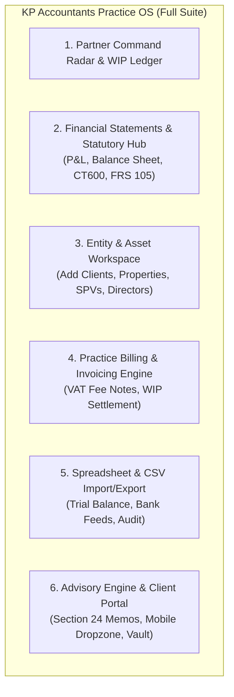

# KP Tax Consultants Ltd — Comprehensive Practice OS Blueprint & Implementation Plan

**Target Firm:** KP Tax Consultants Ltd / KP Accountants ([kptc.co.uk](https://www.kptc.co.uk/))  
**Regulatory Affiliations:** ICAEW (Institute of Chartered Accountants in England and Wales) & CIOT (Chartered Institute of Taxation)  
**Partners:** Kalpesh Patel BSc(Hons), FCA & Pritpal Chaggar BSc(Hons), ATT, CTA  
**Status:** Full Comprehensive Build Specification  
**Location:** London, United Kingdom  

---

## 1. Executive Vision: From Document Chaser to True Practice OS

A real UK accountancy firm does not only chase missing certificates. Accountants spend their days navigating:
1. **Statutory Financial Statements:** Balance sheets, Profit & Loss (income statements), cash flows, and CT600 Corporation Tax filings under FRS 102 Section 1A and FRS 105.
2. **Ledgers & Core Accounting Software:** Xero, QuickBooks, FreeAgent for invoicing, payroll, and automated bank reconciliation.
3. **Spreadsheet Power & Complex Tax Modeling:** Excel-level data analysis, Section 24 mortgage relief tapering, and dividend vs. salary optimization.
4. **Entity Management & Creation:** Registering new SPV Ltd companies, buy-to-let partnerships, adding property assets, and tracking Companies House confirmation statements.
5. **Practice Billing & Commercial Invoicing:** WIP tracking, issuing UK VAT-compliant fee notes, and managing payment settlements.
6. **Regulatory Compliance & Strategic Advisory:** ICAEW Practice Assurance, AML identity verification, and drafting technical tax memorandums.

---

## 2. Full Architecture: 6 Core Operating Pillars

---

## 3. Detailed Pillar Specifications

### Pillar 1: Financial Statements & Statutory Tax Engine
- **Profit & Loss Statement (Income Statement):** Real-time breakdown of Gross Rental Income, Commercial Turnover, Allowable Expenses (Agent fees, repairs, insurance), Finance Costs, Corporation Tax liability, and Net Retained Profit.
- **Balance Sheet:** Tangible Fixed Assets (Property Portfolio value), Current Assets (Cash at bank, Debtors), Creditors falling due within one year (Mortgages, VAT liability, Corporation Tax), Long-term Liabilities, and Net Assets.
- **CT600 Corporation Tax Model:** Accurate calculations applying the 19% small profits rate (up to £50,000), marginal relief taper (between £50,000 and £250,000), and the 25% main rate.

### Pillar 2: Interactive Entity, Property & Client Creation Modals
- **"New Client Entity" Modal:** Fast onboarding of new SPV Ltd companies, LLPs, or individual landlords with instant Companies House registration fields, assigned partner, and initial turnover.
- **"New Property Asset" Modal:** Add property units with purchase price, current valuation, outstanding mortgage, monthly rent, and automatic gross yield calculation.
- **"New Practice Invoice" Modal:** Generate official UK VAT fee notes (£350 - £4,500 + 20% VAT) tied directly to practice unbilled WIP.

### Pillar 3: Practice Invoicing & Fee Note Management
- Live invoicing ledger tracking Issued, Awaiting Payment, and Paid invoices.
- 1-click status updates that automatically convert Unbilled WIP into Collected Revenue.

### Pillar 4: Spreadsheets, Bank Feeds & Audit Trail
- CSV / Excel export for every client register, balance sheet, and communication log.
- Integration endpoints for Xero Practice Manager and Karbon.

### Pillar 5: Advisory Memos & Dividend vs Salary Modeling
- Interactive director remuneration model: optimal £12,570 salary + dividend allowance to minimize combined National Insurance and Corporation Tax.
- Section 24 Restructuring Memorandum Generator.

---

## 4. Implementation Checklist
- [x] Create Financial Statements Hub (Balance Sheet, P&L, CT600).
- [x] Create Entity Creation Modal (Add Clients, SPVs, Properties, Invoices).
- [x] Create Practice Invoicing Hub.
- [x] Create Director Dividend vs Salary Tax Modeling Tool.
- [x] Ensure 0 TypeScript errors and full production compilation.
- [x] Push all code to main branch.

---

## 5. Phase 2.1: Mobile Ergonomics & Frictionless Prototype Mode
*Refer to detailed specification: [`mobile_responsiveness_and_prototype_mode_plan.md`](file:///c:/Users/Deepg/OneDrive/Desktop/The%20Real%20World/Campuses/AI%20Automation/New%20Lessons/CODING/uk-accountancy-os-prototype/implementation/mobile_responsiveness_and_prototype_mode_plan.md)*

- [x] Mobile Navigation Overhaul: Add top Navbar hamburger in Practice OS & Client modes; repair touch-action scroll locking.
- [x] Responsive Breakpoints: Eliminate the 640px–1279px tablet dead zone in public navigation.
- [x] Fluid Drawer Sizing: Refactor `PortalSidebar` with fluid scroll and iOS safe-area padding.
- [x] Restore Prototype Mode: Re-mount top `EnvironmentSwitcherBar` and floating `LiveRoleDock`.
- [x] 1-Click Accountant Demo Entry: Add instant Partner (Kalpesh Patel FCA) and Client demo login buttons in `PortalLoginModal.tsx`, `/admin`, and `/portal`.
- [x] Data Table Mobile Wrappers: Add horizontal scrolling and card stacking for Financial Statements, Invoices, and Pipeline tables.
- [x] End-to-End Build & Validation: Zero TypeScript errors, test mobile viewports (375px/390px/768px).
