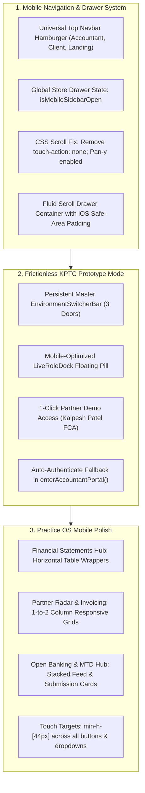

# KP Tax Consultants Ltd — Mobile Responsiveness & Prototype Mode Blueprint

**Target Firm:** KP Tax Consultants Ltd / KP Accountants ([kptc.co.uk](https://www.kptc.co.uk/))  
**Regulatory Affiliations:** ICAEW & CIOT  
**Senior Partners:** Kalpesh Patel BSc(Hons), FCA & Pritpal Chaggar BSc(Hons), ATT, CTA  
**Status:** Mobile Optimization & Prototype Mode Implementation Specification  
**Version:** 2.1 (Mobile Ergonomics & Frictionless Accountant Evaluation)

---

## 1. Problem Statement & Audit Findings

During self-auditing and preparatory reviews for KPTC accountants:
1. **Sidebar Navigation Malfunction on Mobile:**
   - In `accountant` and `client` modes, the top `Navbar` lacks a mobile hamburger button. Users cannot find a top-level menu trigger.
   - The fallback bottom-left floating button (`fixed bottom-4 left-4`) is easily obscured by mobile browser chrome, navigation bars, or safe areas.
   - In `app/globals.css`, `body.modal-open` has `touch-action: none !important;`, which inadvertently blocks touch gestures, panning, and swiping inside slide-over drawers on iOS Safari and mobile Chrome.
   - Vertical flex collisions in `SidebarContent` (`h-full flex flex-col justify-between`) clip the lower navigation actions on compact smartphones.
   - In `Navbar.tsx`, an unhandled breakpoint gap exists between `sm` (640px) and `xl` (1280px) on the landing page, hiding both desktop links and the mobile hamburger on iPads and tablets.
2. **Prototype Review Friction:**
   - Recent commits enforced strict, empty-password authentication walls that require unknown credentials (`mercianwealthgs@gmail.com`).
   - The persistent `EnvironmentSwitcherBar` and `LiveRoleDock` were unmounted from `app/page.tsx`, preventing KPTC accountants from seamlessly touring and evaluating the platform's 8 Practice OS tools and 4 Client Portal modules.

---

## 2. Solution Architecture

---

## 3. Detailed Component Plan

### A. Navigation & Store Architecture (`lib/store.tsx`, `components/shared/Navbar.tsx`, `components/shared/PortalSidebar.tsx`)
1. **Global Sidebar Drawer State in `lib/store.tsx`**:
   - Add `isMobileSidebarOpen: boolean`
   - Add `setMobileSidebarOpen: (open: boolean) => void`
   - Add `toggleMobileSidebar: () => void`
2. **Universal Hamburger Button in `Navbar.tsx`**:
   - In `accountant` mode: Add a prominent hamburger button next to the KP logo that calls `toggleMobileSidebar()`.
   - In `client` mode: Add a prominent hamburger button next to the KP logo that calls `toggleMobileSidebar()`.
   - In `landing` mode: Standardize breakpoints (`hidden lg:flex` for desktop nav, `flex lg:hidden` for mobile hamburger) to eliminate the tablet gap.
3. **Drawer Fixes in `PortalSidebar.tsx`**:
   - Bind open/close directly to `isMobileSidebarOpen`.
   - Replace rigid vertical flex with a fluid `flex-1 overflow-y-auto min-h-0` scroll container.
   - Add `pb-safe` / `pb-8` to ensure the lower action buttons are fully accessible on all phones.
4. **CSS Touch Gesture Fix in `app/globals.css`**:
   - Remove `touch-action: none;` from `body.modal-open` so mobile touch scrolling works smoothly inside modals and slide-out drawers.

### B. Prototype Mode Restoration (`app/page.tsx`, `components/shared/EnvironmentSwitcherBar.tsx`, `components/shared/LiveRoleDock.tsx`, `components/shared/PortalLoginModal.tsx`, `app/admin/page.tsx`, `app/portal/page.tsx`)
1. **Re-mount Master Environment Switcher**:
   - Restore `<EnvironmentSwitcherBar />` in `app/page.tsx` and routes `/admin`, `/portal`.
   - Ensure the switcher displays the official KP Tax Consultants branding and lets testers jump between **1. Public Practice Portal**, **2. Accountant Practice OS (Kalpesh Patel FCA)**, and **3. Landlord Dropzone & Vault (Marcus Sterling)** with 1 tap.
2. **Re-mount Live Role Quick Dock**:
   - Restore `<LiveRoleDock />` with mobile-optimized layout (collapsible floating button that doesn't block viewport controls).
3. **1-Click Demo Login Bypass**:
   - In `PortalLoginModal.tsx`, add a high-visibility button: `⚡ 1-Click Partner Demo Access (Kalpesh Patel FCA)` and `⚡ 1-Click Landlord Client Access`.
   - On `/admin` and `/portal`, offer instant demo entry buttons alongside the credential form.
   - In `lib/store.tsx`, update `enterAccountantPortal()` and `enterClientPortal()` so that if the user isn't logged in, it automatically logs in the appropriate demo user with a helpful notification instead of halting.

### C. Mobile Viewport Optimization Across Practice OS Modules
1. **Financial Statements Hub (`FinancialStatementsHub.tsx`)**:
   - Add `overflow-x-auto` wrappers around Balance Sheet and P&L tables with `-webkit-overflow-scrolling: touch`.
   - Ensure tab buttons for P&L, Balance Sheet, and CT600 scroll horizontally or stack neatly on mobile screens.
2. **Partner Radar (`PartnerRadar.tsx`) & Invoicing Hub (`PracticeInvoicingHub.tsx`)**:
   - Ensure KPI metrics wrap cleanly (`grid-cols-1 sm:grid-cols-2 lg:grid-cols-4`).
   - Add horizontal scroll or card view for missing document chasing lists.
3. **Open Banking & MTD Hub (`OpenBankingHub.tsx`)**:
   - Ensure bank account cards and quarterly submission timelines stack cleanly on mobile viewports.
4. **Touch Targets (WCAG 2.2 AA)**:
   - Ensure all buttons and touch targets are at least 44x44px.

---

## 4. Execution Checklist
- [x] Update `lib/store.tsx` with mobile sidebar drawer state and seamless demo fallback.
- [x] Fix `app/globals.css` touch-action lock.
- [x] Update `Navbar.tsx` with universal mobile hamburger button and unified breakpoints.
- [x] Update `PortalSidebar.tsx` with fluid scroll, store state binding, and safe-area padding.
- [x] Mount `EnvironmentSwitcherBar` and `LiveRoleDock` in `app/page.tsx`.
- [x] Add 1-click Demo Entry buttons in `PortalLoginModal.tsx`, `app/admin/page.tsx`, and `app/portal/page.tsx`.
- [x] Audit and polish mobile layouts for Financial Statements, Partner Radar, Invoicing, and Open Banking.
- [x] Execute `npm run build` to verify 0 TypeScript/build errors.
- [x] Test on simulated mobile screen dimensions (375px, 390px, 768px).
- [x] Commit and push to git repository.
