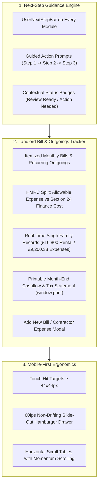

# KP Tax Consultants Ltd — User Guidance Clarity & Landlord Bill Tracker Implementation Plan

**Target Firm:** KP Tax Consultants Ltd / KP Accountants ([kptc.co.uk](https://www.kptc.co.uk/))  
**Regulatory Accreditations:** ICAEW & CIOT (Chartered Tax Advisers)  
**Senior Leadership:** Kalpesh Patel BSc(Hons), FCA & Pritpal Chaggar BSc(Hons), ATT, CTA  
**Status:** Comprehensive Architecture & Implementation Specification  
**Version:** 3.0 (Next-Step Guidance, Notion-Style Landlord Bill Tracker & 60fps Design System)  

---

## 1. Executive Summary & Design Philosophy

This plan addresses a fundamental principle of commercial software engineering and high-converting client experiences: **every interaction must have an unmistakable next step**. When a landlord or accountant opens any page, modal, or drawer, the system must immediately and intuitively answer:
1. *Where am I right now?* (Context & Active Portfolio)
2. *What is my current compliance status?* (Live numbers, missing items, tax liability)
3. *What is the exact next action I need to take?* (Clear, unambiguous button or guided flow)

Additionally, this plan introduces a dedicated **Landlord Property Bill & Outgoings Hub (Printable Monthly Cashflow & Tax Tracker)**, directly addressing real landlord pain points: transitioning away from cumbersome paper ledger notebooks or disconnected Notion spreadsheets into an integrated UK property expense tracker that auto-categorizes expenses under HMRC statutory rules and generates print-ready monthly statements.

---

## 2. Design System Audit & Inspiration Synthesis

### Reference Site Analysis:
- **`motionsites.ai` & `60fps.design`**:
  - Implement physics-based tactile transitions: `active:scale-[0.98]` on click, subtle spring feedback, and non-blocking drawer animations.
  - 60fps hardware-accelerated animations using `transform` and `opacity` only (avoiding expensive layout reflows).
  - High-clarity micro-badges that pulse when attention is required.
- **`navbar.gallery`**:
  - Crystal-clear navigation hierarchy: Brand -> Active Portfolio -> Next-Step Breadcrumb -> Primary Action CTA.
  - Mobile hamburger overlay that is completely scroll-locked, preventing background movement or jitter.
- **`footer.design`**:
  - Institutional British accountancy structure: Firm background, verified Companies House registration (No. 12908850), dual office locations (167-169 Great Portland Street & 7 Bell Yard), direct WhatsApp API channels, and full regulatory disclosure.

### Visual & Architectural Rules:
- **Strict 8px Grid System**: Every margin, padding, and gap adheres to the 8px baseline (`p-2` = 8px, `p-4` = 16px, `p-6` = 24px, `p-8` = 32px, `gap-4` = 16px, `gap-6` = 24px).
- **Tabular Monospace Typography**: All financial figures, tax thresholds, and currency calculations render in tabular monospace (`font-mono tracking-tight`) to ensure clear accounting legibility.
- **Color Semantics**:
  - Primary Slate (`#0F172A`): Institutional authority, borders, and partner branding.
  - Emerald Green (`#047857`): Allowable expenses, verified vouchers, and tax savings.
  - Amber Gold (`#D97706`): Section 24 restrictions, pending certificates, and actions required.
  - Rose Red (`#BE123C`): Overdue HMRC deadlines or critical gaps.

---

## 3. Core Modules & Enhancements

### Module 1: Next-Step Guidance Engine (`UserNextStepBar.tsx`)
A universal, responsive banner embedded at the top of working views with:
- **Contextual Step Indicator**: E.g., `Step 2 of 3: Upload Missing Mortgage Certificate`.
- **Reasoning / Tax Impact**: Explains *why* this step is required under UK tax rules (e.g., "HMRC Section 24 rules require mortgage statements to claim your 20% basic rate tax reducer").
- **Direct 1-Click Action Button**: Directly triggers the required workflow (e.g., switches to Dropzone, opens consultation modal, or launches printer).

### Module 2: Landlord Property Bill & Outgoings Hub (`LandlordBillTrackerHub.tsx`)
A dedicated component added to the Client Portal (and visible in Practice OS):
- **Overview Metrics**:
  - Gross Rental Income (£/month and £/year)
  - Total Allowable Expenses (£)
  - Section 24 Restricted Finance Costs (£)
  - Net Monthly Cashflow (£)
- **Live Bill Roster**:
  - Filter by category: All, Mortgage Interest, Maintenance & Repairs, Letting Fees, Statutory Rates & Utilities.
  - Direct status indicator (Paid, Due, Reconciled with Tax Vault).
  - Linked receipt voucher preview.
- **1-Click Printable Statement**:
  - Formatted specifically for clean physical printing or PDF saving (`@media print` clean stylesheet).
  - Includes practice regulatory header, landlord reference, and date-stamped totals.
- **Quick Bill Submission Modal**:
  - Modal form allowing landlords to log new recurring or one-off expenses (e.g., Gas Safety CP12 certificate, plumbing repair, ground rent payment).

### Module 3: Store & Type Synchronization (`lib/types.ts`, `lib/store.tsx`)
- Add `client_bills` to `ScreenView` union.
- Extend `LandlordClient` interface with `bills: PropertyBillItem[]`.
- Populate initial bills for the Singh Family (£16,800 rental, OpenRent £120, Bathroom Refurb £5,000, Ground Rent £294, Service Charge £3,752.88, Council Tax £33.50, Mortgage Interest £6,330.72) and Sterling Holdings.
- Add `addNewBill(clientId: string, bill: NewBillInput)` action to `useDemoStore`.

---

## 4. Implementation Steps & Checklist

- [x] Create this comprehensive implementation plan in `/implementation/user_guidance_clarity_and_bill_tracker_plan.md`.
- [ ] Add `PropertyBillItem` type definition and extend `ScreenView` in `lib/types.ts`.
- [ ] Add bill state management, initial bills data, and `addNewBill` action in `lib/store.tsx`.
- [ ] Create `components/shared/UserNextStepBar.tsx` for guided next-step prompts.
- [ ] Create `components/portal/LandlordBillTrackerHub.tsx` with live figures, print stylesheet, and add-bill modal.
- [ ] Integrate Bill Tracker into `PortalSidebar.tsx`, `Navbar.tsx`, `app/portal/page.tsx`, and `app/page.tsx`.
- [ ] Embed `UserNextStepBar` on Client Overview, Dropzone, and Financial Statements Hub.
- [ ] Execute `npm run build` to confirm 0 compilation, TypeScript, and linting errors.
- [ ] Git commit and git push to GitHub repository.
